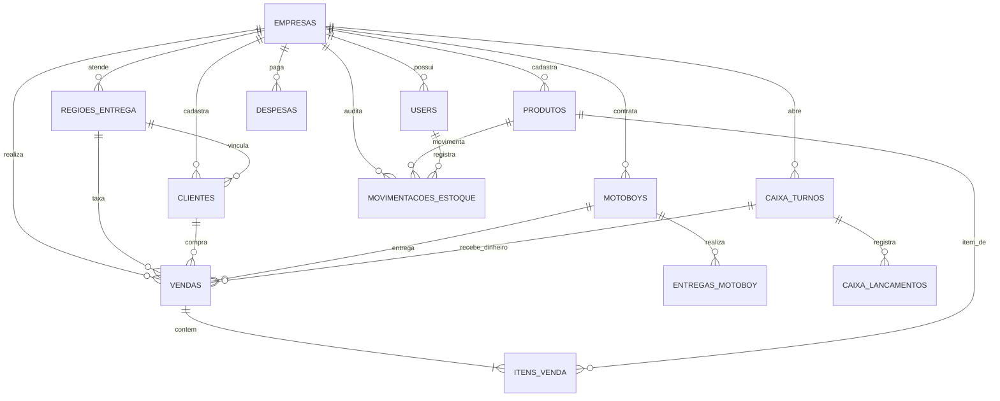

# 📘 Documentação Técnica Completa — GESTOR MEI

> **Sistema:** Gestor MEI — Plataforma de Gestão Integrada para Microempreendedores Individuais  
> **Versão Atual:** 1.4.0 (Sprints 1 a 6.5 Concluídas + Sprint 7 Painel do Consultor LPTI Tech Concluído)  
> **Data do Documento:** 29 de Outubro de 2026  
> **Autor / Mantenedor:** Leonidas Paulino / Equipe LPTI Tech  
> **Arquivo:** `GESTOR_MEI_DOCUMENTACAO_COMPLETA.md`  
> **Repositório:** [https://github.com/leonidas-paulino/gestor-mei.git](https://github.com/leonidas-paulino/gestor-mei.git)

---

## 1. Visão Geral do Projeto

### 1.1 Nome do Sistema
**GESTOR MEI** (ou Gestor MEI SaaS)

### 1.2 Objetivo do Sistema
O Gestor MEI é uma plataforma web completa em modelo SaaS (Software as a Service), projetada sob medida para resolver os gargalos operacionais, logísticos e fiscais enfrentados no dia a dia do Microempreendedor Individual (MEI). O sistema substitui controles manuais, anotações em papel ("caderninho") e planilhas desconexas por uma solução centralizada, auditável e de alta velocidade.

### 1.3 Público-Alvo
- **Segmento Principal:** Pequenos negócios de alimentação (marmitarias, lanchonetes, hamburguerias, pizzarias, bares, restaurantes populares, docerias, açaí, marmitas fitness e delivery de refeições).
- **Segmento Secundário:** Pequenos varejos e prestadores de serviços (mini mercearias, distribuidoras de bebidas, barbearias, assistências técnicas e comércios de bairro).

### 1.4 Modelo SaaS & Multiempresa
- **Arquitetura Multi-Tenant:** Um único backend atende múltiplas empresas com isolamento rígido em nível de banco de dados (`empresa_id`).
- **Planos Modulares por Feature Flags:**
  - `modulo_delivery` (Gestão de pedidos para viagem e delivery próprio)
  - `modulo_motoboy` (Despacho de motoboys e acerto de taxas)
  - `modulo_ifood` (Lançamento e conciliação de vendas com taxas do marketplace)
  - `modulo_estoque` (Controle patrimonial de matérias-primas e revenda)

### 1.5 Diferenciais do Produto
1. **PDV com Carrinho Ultra-Rápido:** Finalização de pedidos com múltiplos itens em menos de 10 segundos no balcão.
2. **Fechamento Cego de Caixa:** O operador conta o dinheiro em espécie sem saber o saldo do sistema, evitando desvios e garantindo apuração precisa de sobras ou faltas.
3. **Logística de Delivery Integrada:** Bairros cadastrados com taxa fixa de frete, pipeline visual Kanban (*Recebido ➔ Em Preparo ➔ Saiu para Entrega ➔ Entregue*) e acerto financeiro automatizado com entregadores parceiros.
4. **Impressão Térmica ESC/POS:** Geração de comandas prontas para bobinas de 58mm e 80mm tanto para o operador de balcão quanto para expedição de cozinha.
5. **Controle de Estoque Inteligente (Sprint 4):** Baixa automática no PDV por item vendido, estorno automático em cancelamento, entradas com custo médio, saídas operacionais justificadas (perdas/avarias) e ajuste de inventário.
6. **Prevenção de Desenquadramento Fiscal (DASN-SIMEI):** Monitoramento contínuo do teto anual de R$ 81.000,00 com separação automática de faturamento entre **Comércio (Produtos)** e **Serviços** conforme o Art. 68 da Resolução CGSN nº 140/2018, emitindo relatórios oficiais em PDF e Excel.
7. **Dashboard Inteligente:** Saudação contextual por turno com emoji, higienização do nome do empreendedor e motor de insights priorizados em 6 camadas (vencimento do DAS, estoque crítico, crescimento de receita e vendas do turno).

---

## 2. Tecnologias Utilizadas

### 2.1 Backend
| Componente | Tecnologia | Versão / Detalhes |
| :--- | :--- | :--- |
| **Linguagem** | Python | 3.11+ (homologado em Python 3.15.2) |
| **Framework Web** | FastAPI | 0.110.1+ (alta performance assíncrona, ASGI nativo) |
| **Servidor ASGI** | Uvicorn | 0.29.0+ |
| **ORM / Banco** | SQLAlchemy | 2.0+ (suporte a SQLite e PostgreSQL) |
| **Validação / Schemas** | Pydantic v2 | 2.7.0+ (com validação estrita e `email-validator`) |
| **Criptografia / Senhas**| Passlib + Bcrypt | Hashing seguro de senhas com algoritmo Bcrypt |
| **Tokens de Acesso** | Python-JOSE | Geração e validação de JWT (JSON Web Tokens) |
| **Geração de PDF** | ReportLab | 4.2.0+ (renderização vetorial de relatórios fiscais) |
| **Geração de Planilhas**| OpenPyXL | 3.1.2+ (exportação em formato XLSX formatado) |
| **Testes Automatizados**| Pytest + HTTPX | 9.2.0+ / Starlette TestClient |

### 2.2 Frontend
| Componente | Tecnologia | Versão / Detalhes |
| :--- | :--- | :--- |
| **Linguagem** | TypeScript | 5.4.5+ (tipagem estrita ponta a ponta) |
| **Biblioteca Base** | React | 18.2.0 (SPA reativo) |
| **Build & Dev Tool** | Vite | 5.2.8 (Hot Module Replacement instantâneo) |
| **UI Framework** | Material UI (MUI)| v5.15.15 |
| **Engine de Estilos** | Emotion | `@emotion/react` 11.11.4, `@emotion/styled` 11.11.5 |
| **Ícones Visuais** | MUI Icons + Lucide | `@mui/icons-material` e `lucide-react` |
| **Visualização de Dados**| Recharts | 2.12.5 (Gráficos de Área, Barras e Pizza) |
| **Roteamento SPA** | React Router DOM | 6.22.3 (Rotas protegidas com controle de perfil) |
| **Cliente HTTP** | Axios | 1.6.8 (Interceptors de token JWT e baseURL dinâmica) |
| **Exportação no Cliente**| jsPDF + AutoTable | 2.5.1 / 3.8.2 e `xlsx` 0.18.5 |

### 2.3 Banco de Dados
- **Banco Atual (Desenvolvimento Local):** SQLite 3 (`backend/gestor_mei.db`), permitindo execução autônoma, zero-configuração e facilidade de backup instantâneo.
- **Bancos Suportados (Produção):** PostgreSQL 14+ via driver `psycopg2` ou `asyncpg`. O SQLAlchemy desacopla o dialeto SQL, bastando apontar a variável `DATABASE_URL`.

### 2.4 Autenticação e Segurança
- **Mecanismo:** Token JWT (*JSON Web Token*) assinado com chave secreta HMAC-SHA256 (`HS256`).
- **Validade do Token:** 1440 minutos (24 horas) por padrão.
- **Armazenamento no Cliente:** `localStorage` com controle de expiração via contexto de autenticação React.
- **Controle de Acesso:** RBAC (*Role-Based Access Control*) com perfis:
  - `ADMIN`: Administrador/Proprietário com acesso total.
  - `OPERADOR`: Funcionário/Atendente focado em PDV, pedidos, clientes e caixa.

### 2.5 Testes
- **Framework:** Pytest 9.2.0 integrado com FastAPI TestClient.
- **Quantidade de Testes:** **19 testes automatizados** cobrindo 100% dos fluxos das Sprints 2, 3 e 4.

### 2.6 Ferramentas de Desenvolvimento e Gestão
- **Controle de Versão:** Git 2.40+
- **Repositório Remoto:** GitHub (`leonidas-paulino/gestor-mei`)
- **Ambiente de Orquestração:** Antigravity Agentic IDE
- **Automação de Scripts:** PowerShell 5.1 / 7+ no Windows

---

## 3. Linguagens Utilizadas e Suas Finalidades

```
┌────────────────────────────────────────────────────────────────────────┐
│                        LINGUAGENS DO GESTOR MEI                        │
├─────────────────┬──────────────────────────────────────────────────────┤
│ Python          │ Backend, APIs REST, Regras de Negócio, ORM, Testes   │
├─────────────────┼──────────────────────────────────────────────────────┤
│ TypeScript      │ Frontend React, Tipagem de Dados, Componentes, Telas │
├─────────────────┼──────────────────────────────────────────────────────┤
│ JavaScript      │ Scripts de build Vite, automações npm e polyfills     │
├─────────────────┼──────────────────────────────────────────────────────┤
│ HTML5           │ Estrutura do SPA e template de impressão de comandas  │
├─────────────────┼──────────────────────────────────────────────────────┤
│ CSS3            │ Estilização MUI, temas Claro/Escuro, @media print    │
├─────────────────┼──────────────────────────────────────────────────────┤
│ SQL             │ Consultas relacionais, DDL de tabelas e agregações   │
├─────────────────┼──────────────────────────────────────────────────────┤
│ PowerShell      │ Scripts de inicialização, verificação de portas e ops │
└─────────────────┴──────────────────────────────────────────────────────┘
```

1. **Python (`.py`):** Utilizado em toda a camada do `backend/`. Implementa os modelos SQLAlchemy, rotas FastAPI, geração de tokens JWT, algoritmos de cálculo de faturamento anual, exportadores de PDF (ReportLab) e Excel (OpenPyXL), além de suítes de testes automatizados com Pytest.
2. **TypeScript (`.ts`, `.tsx`):** Utilizado em toda a camada do `frontend/src/`. Assegura integridade estrita de tipagem entre a resposta dos endpoints e os formulários/estados do React.
3. **JavaScript (`.js`, `.cjs`, `.mjs`):** Utilizado nas configurações de empacotamento do Vite (`vite.config.ts`), scripts de build do Rollup e arquivos temporários de teste de infraestrutura.
4. **HTML5 (`.html`):** Utilizado no ponto de entrada `frontend/index.html` e na formatação de páginas de impressão limpa para impressoras térmicas via `window.print()`.
5. **CSS3 (`.css`):** Empregado no reset CSS (`frontend/src/index.css`), estilizações utilitárias e regras avançadas de impressão `@media print` para travamento de largura de bobina (58mm e 80mm sem margens).
6. **SQL (Structured Query Language):** Utilizado na definição e consulta do banco de dados relacional. Executado via SQLAlchemy ORM e em migrações manuais/automáticas com comandos DDL e agregações (`SUM`, `COUNT`, `COALESCE`, `EXTRACT`).
7. **PowerShell (`.ps1`):** Utilizado nos scripts operacionais da raiz (`start-all.ps1`, `start-backend.ps1`, `start-frontend.ps1`) para orquestrar a execução local simultânea no Windows.

---

## 4. Estrutura de Diretórios do Projeto

```text
c:\Users\LeonidasPaulino\Desktop\gestor-mei-main/
│
├── .gitignore                          # Regras unificadas de exclusão Git (.venv, node_modules, etc.)
├── LICENSE                             # Licença do projeto (MIT)
├── README.md                           # Visão geral e instruções rápidas
├── CHANGELOG.md                        # Histórico de versões e alterações por Sprint
├── GESTOR_MEI_DOCUMENTACAO_COMPLETA.md # Este documento técnico completo
├── start-all.ps1                       # Script de inicialização completa (Backend + Frontend)
├── start-backend.ps1                   # Script para iniciar apenas o backend FastAPI na porta 8001
├── start-frontend.ps1                  # Script para iniciar apenas o frontend Vite na porta 5173
│
├── docs/                               # Documentações técnicas e manuais
│   └── HANDOFF.md                      # Manual arquitetural e guia de transição de equipes
│
├── backend/                            # MÓDULO BACKEND (FastAPI + Python)
│   ├── gestor_mei.db                   # Banco de dados SQLite local com dados demonstrativos
│   ├── requirements.txt                # Dependências Python travadas
│   ├── .venv/                          # Ambiente virtual Python isolado (descartável)
│   │
│   ├── tests/                          # Suíte de Testes Automatizados (Pytest)
│   │   ├── test_sprint2_vendas_clientes.py # Testes de Vendas, Carrinho, PDV e Clientes
│   │   ├── test_sprint3_entregas.py        # Testes de Regiões, Taxas, Motoboys e Comanda ESC/POS
│   │   └── test_sprint4_estoque.py         # Testes de Estoque, Entradas, Baixas e Ajustes
│   │
│   └── app/                            # Pacote principal da aplicação backend
│       ├── __init__.py
│       ├── main.py                     # Entrypoint da aplicação, middlewares CORS e rotas
│       ├── config.py                   # Configurações de ambiente (Pydantic Settings)
│       ├── database.py                 # Configuração do Engine SQLAlchemy e SessionLocal
│       ├── dependencies.py             # Dependências de injeção (autenticação, roles, empresa)
│       ├── security.py                 # Funções criptográficas (hash bcrypt e JWT)
│       ├── seed.py                     # Inserção automática de dados demonstrativos
│       ├── migrate_sprint2.py          # Script de migração da Sprint 2
│       ├── migrate_sprint3.py          # Script de migração da Sprint 3
│       ├── migrate_sprint4.py          # Script de migração da Sprint 4 (Estoque)
│       │
│       ├── models/                     # Modelos relacionais (SQLAlchemy ORM)
│       │   ├── empresa.py              # Cadastro da empresa e feature flags
│       │   ├── user.py                 # Usuários do sistema (ADMIN e OPERADOR)
│       │   ├── produto.py              # Catálogo com preço, custo e estoque
│       │   ├── estoque.py              # Movimentações de estoque (ENTRADA, SAIDA, AJUSTE)
│       │   ├── cliente.py              # Cadastro de clientes e endereço
│       │   ├── regiao_entrega.py       # Bairros atendidos e taxas de entrega
│       │   ├── venda.py                # Venda e ItemVenda (carrinho 1:N)
│       │   ├── caixa.py                # Turnos e lançamentos de frente de caixa
│       │   ├── despesa.py              # Despesas operacionais e fixas
│       │   ├── motoboy.py              # Cadastro de entregadores e taxas
│       │   └── ifood.py                # Vendas e taxas do canal iFood
│       │
│       ├── schemas/                    # Contratos de entrada e saída (Pydantic DTOs)
│       │   ├── auth.py, cliente.py, empresa.py, estoque.py, produto.py,
│       │   ├── regiao_entrega.py, user.py, venda.py, caixa.py, despesa.py,
│       │   ├── motoboy.py, ifood.py, dashboard.py, relatorio_mei.py
│       │
│       └── routers/                    # Controladores da API REST segregados por domínio
│           ├── auth.py                 # Login, registro e obtenção do perfil logado
│           ├── dashboard.py            # Métricas e KPIs em tempo real
│           ├── clientes.py             # CRUD e histórico de compras de clientes
│           ├── produtos.py             # Catálogo de produtos e serviços
│           ├── estoque.py              # Entradas, saídas manuais, ajustes e alertas
│           ├── vendas.py               # PDV, carrinho, cancelamento e comanda térmica
│           ├── caixa.py                # Abertura, fechamento cego e sangrias
│           ├── despesas.py             # Gestão de gastos e conciliação
│           ├── regioes_entrega.py      # Bairros atendidos e precificação de frete
│           ├── motoboys.py             # Logística, corridas e quitação de diárias
│           ├── ifood.py                # Integração com lançamentos do marketplace
│           ├── relatorio_mei.py        # Apuração DASN-SIMEI com PDF e Excel
│           ├── relatorio_entregas.py   # Análise financeira de logística
│           ├── saude_negocio.py        # DRE simplificado e lucratividade líquida
│           ├── users.py                # Gestão de operadores da empresa
│           ├── empresas.py             # Dados cadastrais e ativação de módulos
│           └── backup.py               # Exportação e backup da base de dados
│
└── frontend/                           # MÓDULO FRONTEND (React + Vite + TypeScript)
    ├── package.json                    # Dependências npm e scripts de compilação
    ├── tsconfig.json                   # Configurações do compilador TypeScript
    ├── vite.config.ts                  # Configurações do Vite e proxy reverso para backend
    ├── index.html                      # Ponto de entrada do SPA
    ├── node_modules/                   # Dependências instaladas (descartável)
    │
    └── src/
        ├── main.tsx                    # Inicializador do React DOM
        ├── App.tsx                     # Definição de rotas públicas e protegidas
        ├── index.css                   # Estilos globais e regras para impressão térmica
        │
        ├── types/
        │   └── index.ts                # Interfaces e tipos TypeScript centralizados
        │
        ├── services/
        │   ├── api.ts                  # Instância Axios com injeção automática de JWT
        │   └── exportUtils.ts          # Utilitários de formatação de moeda e datas
        │
        ├── contexts/
        │   ├── AuthContext.tsx         # Provedor global de autenticação e sessão
        │   └── ThemeContext.tsx        # Provedor de alternância Claro / Escuro
        │
        ├── components/
        │   ├── Layout.tsx              # Sidebar responsiva, menu e topo do sistema
        │   ├── DashboardGreeting.tsx   # Cabeçalho inteligente, saudação e insights
        │   ├── ApiStatusIndicator.tsx  # Status de conexão visual em tempo real (🟢/🔴)
        │   ├── StatCard.tsx            # Card padrão para indicadores e KPIs
        │   └── ConfirmDialog.tsx       # Modal de confirmação para ações destrutivas
        │
        └── pages/                      # Telas da aplicação (Views)
            ├── Login.tsx               # Autenticação de usuários
            ├── Dashboard.tsx           # Visão geral e métricas operacionais
            ├── Vendas.tsx              # Frente de Caixa PDV com carrinho e comanda
            ├── PedidosEntrega.tsx      # Kanban visual de pedidos de delivery
            ├── RegioesEntrega.tsx      # Gestão de bairros e taxas de frete
            ├── Clientes.tsx            # Base de clientes com link WhatsApp
            ├── Produtos.tsx            # Cadastro de itens com custo e estoque
            ├── Estoque.tsx             # Movimentações, inventário e saldo crítico
            ├── Caixa.tsx               # Turnos, suprimentos e fechamento cego
            ├── Despesas.tsx            # Lançamento e categorização de despesas
            ├── Motoboys.tsx            # Gerenciamento de entregadores e acertos
            ├── IFood.tsx               # Controle de pedidos e taxas do iFood
            ├── RelatorioMei.tsx        # Demonstrativo DASN-SIMEI com PDF/Excel
            ├── RelatorioEntregas.tsx   # Rentabilidade de taxas de entrega
            ├── SaudeNegocio.tsx        # Indicadores de saúde e margens
            ├── Usuarios.tsx            # Cadastro e permissões de operadores
            └── Configuracoes.tsx       # Dados da empresa e ativação de módulos
```

---

## 5. Funcionalidades Implementadas

### Sprint 1: Fundação SaaS, PDV & Controle Financeiro Básico
- Autenticação com JWT, hash Bcrypt e perfil de acesso (`ADMIN` e `OPERADOR`).
- Multiempresa com isolamento estrito por `empresa_id`.
- Dashboard Executivo com faturamento diário, semanal, mensal e anual.
- Catálogo de Produtos e Serviços com preços e categorias.
- PDV rápido com registro de venda e seleção de forma de pagamento (*Dinheiro, PIX, Cartão Débito, Cartão Crédito*).
- Controle de Frente de Caixa com abertura de turno, sangria, reforço e **fechamento cego** (conferência do valor físico sem revelar o saldo do sistema).
- Lançamento de despesas fixas e variáveis com categorias operacionais.
- Relatório Anual DASN-SIMEI com acompanhamento em tempo real do teto de R$ 81.000,00 e exportação oficial em PDF e planilha Excel.

### Sprint 2: Carrinho de Compras 1:N & Base de Clientes Fiéis
- Refatoração da venda para modelo relacional **1:N** (`Venda` e `ItemVenda`).
- Carrinho de compras interativo no PDV: adição, remoção, alteração de quantidade e subtotal automático por item.
- Base de Clientes com busca instantânea por nome, telefone ou CPF/CNPJ.
- Integração de contato com botão de redirecionamento direto para **WhatsApp** (`https://wa.me/55...`).
- Histórico completo de pedidos anteriores associados ao cliente.
- Desconto em valor monetário aplicado sobre o subtotal do carrinho.
- Cancelamento auditado de vendas com estorno automático de caixa.

### Sprint 3: Gestão de Delivery, Logística de Motoboys & Comanda ESC/POS
- Cadastro de Regiões de Entrega e Bairros com taxa fixa de frete e tempo estimado.
- Associação automática de região e taxa de frete no momento da seleção do cliente.
- Pipeline Operacional de Delivery em formato Kanban com 4 status:
  - `Recebido ➔ Em Preparo ➔ Saiu para Entrega ➔ Entregue`
- Cadastro de Motoboys com taxa configurável por entrega.
- Vinculação de entregador ao pedido e acompanhamento de taxa devida.
- Painel de acerto de contas com motoboys: listagem de entregas pendentes, quitação individual e quitação em lote de diárias.
- Relatório Financeiro de Logística: total de frete cobrado do cliente vs. total pago aos motoboys com saldo de resultado.
- Gerador de Comanda Térmica ESC/POS: endpoint gerando payload de texto estruturado para impressoras de 58mm (32 colunas) e 80mm (48 colunas) com impressão direta pelo navegador.

### Sprint 4: Controle Completo de Estoque, Custos & Alertas Patrimoniais
- Modelagem de estoque na entidade `Produto`: `quantidade_estoque`, `estoque_minimo` e `custo_unitario`.
- Criação da entidade `MovimentacaoEstoque` com auditoria completa de usuário, tipo, motivo e data.
- **Entrada Manual de Mercadorias:** Registro de reposição com quantidade, motivo e atualização opcional do custo unitário.
- **Saída Manual Operacional:** Baixa de estoque por motivos operacionais (*Perda, Avaria, Consumo Interno, Validade Vencida, Descarte*).
- **Ajuste de Inventário Físico:** Correção de saldo em caso de divergência de contagem, calculando automaticamente a diferença.
- **Baixa Automática no PDV:** Ao concluir uma venda com produtos, o saldo de estoque é reduzido automaticamente e a movimentação de saída é gravada.
- **Estorno Automático no Cancelamento:** O cancelamento de uma venda devolve os itens ao estoque físico registrando movimentação de estorno.
- Tela dedicada [Estoque.tsx](file:///c:/Users/LeonidasPaulino/Desktop/gestor-mei-main/frontend/src/pages/Estoque.tsx) com 4 KPIs:
  - Total de Itens Cadastrados
  - Produtos em Nível Crítico (Estoque Baixo)
  - Valor Total do Estoque a Preço de Custo (Patrimônio)
  - Faturamento Potencial a Preço de Venda
- Filtro por situação (*Todos, Normais, Estoque Baixo, Sem Estoque*), busca por nome e aba de histórico cronológico de movimentações.
- Script de migração unificado `migrate_sprint4.py` compatível com SQLite e PostgreSQL.

### Feature Adicional: Dashboard Inteligente & Status do Sistema
- **Saudação Contextual por Turno:**
  - 05:00 às 11:59: `☀️ Bom dia, {nome}!`
  - 12:00 às 17:59: `👋 Boa tarde, {nome}!`
  - 18:00 às 04:59: `🌙 Boa noite, {nome}!`
- **Higienização do Nome:** Exibição cordial do primeiro nome do usuário autenticado.
- **Motor de Insights em 6 Camadas de Prioridade:** Avaliação sequencial de alertas para exibir a informação mais relevante ao empreendedor.
- **Indicador de Status em Tempo Real:** Componente visual no topo indicando conectividade da API e do banco de dados (`🟢 Sistema Online` / `🔴 Sistema Offline`).

---

## 6. Telas Implementadas

| # | Tela | Arquivo | Finalidade | Funcionalidades Principais | APIs Utilizadas |
| :---: | :--- | :--- | :--- | :--- | :--- |
| **1** | **Login** | `Login.tsx` | Autenticação no sistema | Login com e-mail/senha, feedback de erro, persistência de token JWT e redirecionamento. | `POST /api/auth/login`<br>`GET /api/auth/me` |
| **2** | **Dashboard** | `Dashboard.tsx`<br>`DashboardGreeting.tsx` | Visão executiva em tempo real | Saudação inteligente, insights prioritários, KPIs de vendas, caixa, ticket médio, lucro, gráficos de evolução e alerta de estoque. | `GET /api/dashboard`<br>`GET /api/produtos` |
| **3** | **PDV / Vendas** | `Vendas.tsx` | Frente de caixa e registro de pedidos | Adição de produtos ao carrinho, busca de cliente, cálculo de troco, taxas de entrega, emissão e impressão de comanda térmica. | `GET /api/produtos`<br>`GET /api/clientes`<br>`POST /api/vendas`<br>`GET /api/caixa/status`<br>`GET /api/vendas/{id}/comanda-texto` |
| **4** | **Pedidos & Delivery** | `PedidosEntrega.tsx` | Gestão operacional de entregas | Painel Kanban com colunas de status, avanço de etapa, atribuição de motoboy e impressão de comanda de entrega. | `GET /api/vendas`<br>`PUT /api/vendas/{id}/status-pedido`<br>`PUT /api/vendas/{id}/vincular-motoboy` |
| **5** | **Regiões de Entrega** | `RegioesEntrega.tsx` | Configuração de fretes | Cadastro de bairros e rotas com valor fixo da taxa e tempo médio estimado de deslocamento. | `GET /api/regioes-entrega`<br>`POST /api/regioes-entrega`<br>`PUT /api/regioes-entrega/{id}`<br>`DELETE /api/regioes-entrega/{id}` |
| **6** | **Clientes** | `Clientes.tsx` | Gestão de clientes fiéis | Cadastro de clientes com endereço e região, busca rápida e botão de acionamento do WhatsApp. | `GET /api/clientes`<br>`POST /api/clientes`<br>`PUT /api/clientes/{id}`<br>`DELETE /api/clientes/{id}` |
| **7** | **Produtos & Serviços** | `Produtos.tsx` | Catálogo de itens | Cadastro de itens, definição de preço de venda, custo de aquisição, estoque mínimo e tipo (Produto ou Serviço). | `GET /api/produtos`<br>`POST /api/produtos`<br>`PUT /api/produtos/{id}`<br>`DELETE /api/produtos/{id}` |
| **8** | **Controle de Estoque** | `Estoque.tsx` | Gestão física e financeira de estoque | Dashboard com 4 KPIs, tabela de posições com alertas coloridos, histórico de movimentações e modais de Entrada, Baixa e Ajuste. | `GET /api/estoque/resumo`<br>`GET /api/estoque/movimentacoes`<br>`POST /api/estoque/entrada`<br>`POST /api/estoque/saida`<br>`POST /api/estoque/ajuste` |
| **9** | **Caixa Diário** | `Caixa.tsx` | Gestão do fluxo financeiro do turno | Abertura com fundo de troco, sangria, reforço, fechamento cego auditado e histórico de turnos anteriores. | `GET /api/caixa/status`<br>`POST /api/caixa/abrir`<br>`POST /api/caixa/lancamento`<br>`POST /api/caixa/fechar`<br>`GET /api/caixa/historico` |
| **10** | **Despesas** | `Despesas.tsx` | Gestão de saídas financeiras | Lançamento de despesas fixas e variáveis, filtragem por categoria e cálculo do total despendido no mês. | `GET /api/despesas`<br>`POST /api/despesas`<br>`GET /api/despesas/resumo`<br>`DELETE /api/despesas/{id}` |
| **11** | **Motoboys & Logística** | `Motoboys.tsx` | Gestão de entregadores parceiros | Cadastro de motoboys, histórico de entregas realizadas, quitação de corridas avulsas ou quitação total de diárias. | `GET /api/motoboys`<br>`POST /api/motoboys`<br>`GET /api/motoboys/relatorio`<br>`POST /api/motoboys/quitar-todas/{id}` |
| **12** | **iFood & Canais** | `IFood.tsx` | Conciliação de marketplaces | Lançamento de pedidos do iFood com valor bruto e taxa cobrada, calculando o valor líquido recebido pela empresa. | `GET /api/ifood`<br>`POST /api/ifood`<br>`DELETE /api/ifood/{id}` |
| **13** | **Relatório MEI** | `RelatorioMei.tsx` | Apuração DASN-SIMEI | Visão do faturamento acumulado no ano vs. teto de R$ 81.000,00, separação de Comércio e Serviços, exportação em PDF e Excel. | `GET /api/relatorio-mei`<br>`GET /api/relatorio-mei/pdf`<br>`GET /api/relatorio-mei/excel` |
| **14** | **Relatório de Entregas**| `RelatorioEntregas.tsx` | Rentabilidade da logística | Balanço entre taxas de frete arrecadadas de clientes vs. repassadas aos motoboys, com percentual de margem retida. | `GET /api/relatorio-entregas` |
| **15** | **Saúde do Negócio** | `SaudeNegocio.tsx` | DRE e rentabilidade líquida | Comparativo de entradas totais vs. despesas totais, lucro operacional líquido e margem sobre faturamento. | `GET /api/saude-negocio` |
| **16** | **Usuários & Acessos** | `Usuarios.tsx` | Gestão de equipe interna | Cadastro de operadores e administradores, redefinição de senhas e ativação/desativação de contas. | `GET /api/users`<br>`POST /api/users`<br>`PUT /api/users/{id}`<br>`DELETE /api/users/{id}` |
| **17** | **Configurações** | `Configuracoes.tsx` | Parâmetros da empresa | Edição de dados cadastrais (CNPJ, Razão Social, Telefone, Endereço), limite fiscal e ativação de módulos por feature flag. | `GET /api/empresa`<br>`PUT /api/empresa`<br>`PUT /api/empresa/modulos` |

---

## 7. APIs Implementadas (Catálogo de Endpoints)

O sistema possui **62 endpoints RESTful** operando sob o prefixo `/api` com validação de esquema Pydantic:

### 7.1 Autenticação (`/api/auth`)
- `POST /api/auth/login`: Autentica o usuário com email/senha e retorna o JWT com perfil e dados da empresa.
- `POST /api/auth/register`: Cadastro inicial de nova empresa e usuário Administrador.
- `GET /api/auth/me`: Retorna os dados completos do usuário logado e de sua empresa.

### 7.2 Dashboard (`/api/dashboard`)
- `GET /api/dashboard`: Retorna indicadores consolidados (vendas dia/semana/mês/ano, caixa, despesas, gráficos temporais e estoque).

### 7.3 Clientes (`/api/clientes`)
- `GET /api/clientes`: Lista clientes da empresa com busca por texto e ordenação.
- `POST /api/clientes`: Cadastra novo cliente vinculado a uma região de entrega.
- `GET /api/clientes/{cliente_id}`: Retorna os detalhes de um cliente específico.
- `PUT /api/clientes/{cliente_id}`: Atualiza dados cadastrais do cliente.
- `DELETE /api/clientes/{cliente_id}`: Inativa/remove o cliente do cadastro.

### 7.4 Produtos e Serviços (`/api/produtos`)
- `GET /api/produtos`: Lista catálogo com filtros por categoria, tipo e flag de apenas ativos.
- `POST /api/produtos`: Cadastra novo produto ou serviço com estoque e custo unitário.
- `PUT /api/produtos/{produto_id}`: Atualiza parâmetros do produto.
- `DELETE /api/produtos/{produto_id}`: Inativa o produto mantendo histórico fiscal.

### 7.5 Controle de Estoque (`/api/estoque`)
- `POST /api/estoque/entrada`: Registra entrada manual de mercadorias com atualização opcional de custo.
- `POST /api/estoque/saida`: Registra baixa manual justificada (perda, avaria, consumo, descarte).
- `POST /api/estoque/ajuste`: Registra acerto de inventário físico com cálculo de diferença.
- `POST /api/estoque/movimentacao`: Endpoint genérico unificado para movimentações de estoque.
- `GET /api/estoque/movimentacoes`: Retorna histórico auditado filtrado por produto e tipo.
- `GET /api/estoque/resumo`: Panorama patrimonial com total de itens, estoque baixo e valor a custo/venda.
- `GET /api/estoque/baixo`: Lista de produtos cujo estoque está no nível mínimo ou zerado.

### 7.6 Vendas e PDV (`/api/vendas`)
- `GET /api/vendas`: Lista pedidos com filtros por data, status e cliente.
- `POST /api/vendas`: Conclui venda com múltiplos itens, baixa automática no estoque e lançamento no caixa.
- `GET /api/vendas/{venda_id}`: Retorna os detalhes da venda e seus itens discriminados.
- `PUT /api/vendas/{venda_id}/cancelar`: Cancela venda, estorna dinheiro do caixa e estorna itens ao estoque.
- `PUT /api/vendas/{venda_id}/status-pedido`: Atualiza o estágio no Kanban (*Recebido/Em Preparo/Saiu/Entregue*).
- `PUT /api/vendas/{venda_id}/vincular-motoboy`: Associa um entregador ao pedido com taxa de frete.
- `GET /api/vendas/{venda_id}/comanda-texto`: Gera texto puro pronto para bobinas de 58mm e 80mm.

### 7.7 Frente de Caixa (`/api/caixa`)
- `GET /api/caixa/status`: Consulta o estado do caixa atual (Aberto/Fechado) e o saldo em espécie apurado.
- `POST /api/caixa/abrir`: Realiza abertura de turno com valor de fundo de troco inicial.
- `POST /api/caixa/lancamento`: Registra sangria (retirada) ou reforço (suprimento) no turno ativo.
- `POST /api/caixa/fechar`: Realiza o **fechamento cego**, confrontando o valor contado com o esperado.
- `GET /api/caixa/historico`: Lista turnos passados com data, operador, quebras de caixa e lançamentos.

### 7.8 Despesas (`/api/despesas`)
- `GET /api/despesas`: Lista despesas registradas com filtros de período e categoria.
- `POST /api/despesas`: Registra nova despesa operacional com forma de pagamento.
- `GET /api/despesas/resumo`: Agrupamento de despesas por categoria e totalização mensal.
- `PUT /api/despesas/{despesa_id}`: Atualiza descrição ou valor de uma despesa.
- `DELETE /api/despesas/{despesa_id}`: Remove o lançamento de despesa.

### 7.9 Regiões de Entrega (`/api/regioes-entrega`)
- `GET /api/regioes-entrega`: Lista todas as regiões e bairros atendidos com suas taxas.
- `POST /api/regioes-entrega`: Cadastra nova região com valor padrão de frete.
- `GET /api/regioes-entrega/{regiao_id}`: Retorna os detalhes de uma região específica.
- `PUT /api/regioes-entrega/{regiao_id}`: Atualiza a taxa de entrega ou tempo estimado.
- `DELETE /api/regioes-entrega/{regiao_id}`: Inativa ou remove a região.

### 7.10 Motoboys e Logística (`/api/motoboys`)
- `GET /api/motoboys`: Lista motoboys ativos e inativos da empresa.
- `POST /api/motoboys`: Cadastra novo entregador parceiro com valor da taxa de entrega padrão.
- `PUT /api/motoboys/{motoboy_id}`: Atualiza dados cadastrais ou valor por entrega.
- `DELETE /api/motoboys/{motoboy_id}`: Remove ou inativa o motoboy.
- `GET /api/motoboys/entregas`: Lista corridas realizadas com status (*PENDENTE / PAGO*).
- `POST /api/motoboys/entregas`: Registra corrida avulsa realizada pelo motoboy.
- `PUT /api/motoboys/entregas/{entrega_id}/quitar`: Quita individualmente o pagamento de uma corrida.
- `POST /api/motoboys/quitar-todas/{motoboy_id}`: Quita em lote todo o saldo pendente do entregador.
- `GET /api/motoboys/relatorio`: Retorna extrato consolidado com total devido, pago e pendente.

### 7.11 iFood (`/api/ifood`)
- `GET /api/ifood`: Lista lançamentos de vendas realizadas no marketplace.
- `POST /api/ifood`: Registra pedido com valor bruto, taxa comissionada retida e valor líquido.
- `DELETE /api/ifood/{lancamento_id}`: Exclui lançamento incorreto.

### 7.12 Relatórios e Saúde Fiscal (`/api/relatorio-mei`, `/api/relatorio-entregas`, `/api/saude-negocio`)
- `GET /api/relatorio-mei`: Retorna a apuração anual segregada em Comércio e Serviços com limite MEI.
- `GET /api/relatorio-mei/pdf`: Faz o stream do relatório oficial em PDF gerado pelo ReportLab.
- `GET /api/relatorio-mei/excel`: Faz o download da planilha oficial formatada em Excel (`.xlsx`).
- `GET /api/relatorio-entregas`: Retorna métricas de logística (taxas cobradas vs. pagas e margem de entrega).
- `GET /api/saude-negocio`: Apura DRE sintético do negócio (entradas, saídas, resultado líquido).

### 7.13 Usuários e Empresa (`/api/users`, `/api/empresa`)
- `GET /api/users`: Lista operadores e administradores da empresa.
- `POST /api/users`: Cadastra novo operador com controle de perfil (`ADMIN` ou `OPERADOR`).
- `PUT /api/users/{user_id}`: Atualiza dados cadastrais do operador.
- `DELETE /api/users/{user_id}`: Inativa acesso do usuário.
- `GET /api/empresa`: Retorna os dados cadastrais da empresa autenticada.
- `PUT /api/empresa`: Atualiza CNPJ, razão social, nome fantasia e telefone.
- `PUT /api/empresa/modulos`: Ativa ou desativa módulos via feature flags (`delivery`, `motoboy`, `estoque`, `ifood`).

### 7.14 Backup e Health Check (`/api/backup`, `/api/health`, `/`)
- `GET /`: Endpoint raiz informativo com status da API.
- `GET /api/health`: Health check ativo testando comunicação com a base de dados (`SELECT 1`).
- `GET /api/backup/status`: Verifica status dos backups locais gerados.
- `GET /api/backup/export`: Exporta dump local dos dados da empresa.
- `POST /api/backup/gdrive/sync`: Stub para futura sincronização com Google Drive.

---

## 8. Modelo de Dados Relacional (Entity-Relationship)



### 8.1 Detalhamento das 14 Tabelas do Banco de Dados

#### 1. `empresas`
| Campo | Tipo | Descrição / Restrições |
| :--- | :--- | :--- |
| `id` | INTEGER | Chave Primária Autoincremento |
| `nome_empresarial` | VARCHAR(255) | Razão Social registrada no CNPJ |
| `nome_fantasia` | VARCHAR(255) | Nome fantasia do negócio |
| `cnpj` | VARCHAR(30) | Cadastro Nacional de Pessoa Jurídica |
| `cpf_proprietario` | VARCHAR(20) | CPF do titular do MEI |
| `endereco` | VARCHAR(255) | Logradouro e número |
| `telefone` | VARCHAR(50) | Telefone principal de contato |
| `email` | VARCHAR(120) | E-mail oficial da empresa |
| `limite_mei_anual` | FLOAT | Teto fiscal anual (padrão: 81.000,00) |
| `segmento` | VARCHAR(50) | Alimentação, Varejo, etc. |
| `modulo_delivery` | BOOLEAN | Feature flag para habilitar módulo de entrega |
| `modulo_motoboy` | BOOLEAN | Feature flag para habilitar gestão de motoboys |
| `modulo_ifood` | BOOLEAN | Feature flag para habilitar módulo iFood |
| `modulo_estoque` | BOOLEAN | Feature flag para habilitar controle de estoque |
| `created_at` / `updated_at` | DATETIME | Carimbos de data/hora |

#### 2. `users`
| Campo | Tipo | Descrição / Restrições |
| :--- | :--- | :--- |
| `id` | INTEGER | Chave Primária |
| `empresa_id` | INTEGER | FK -> `empresas.id` |
| `nome` | VARCHAR(150) | Nome completo do usuário |
| `email` | VARCHAR(150) | E-mail de login (único) |
| `hashed_password` | VARCHAR(255) | Senha criptografada com Bcrypt |
| `role` | VARCHAR(8) | Perfil de acesso (`ADMIN` ou `OPERADOR`) |
| `ativo` | BOOLEAN | Flag de status da conta |
| `created_at` | DATETIME | Data de criação |

#### 3. `produtos`
| Campo | Tipo | Descrição / Restrições |
| :--- | :--- | :--- |
| `id` | INTEGER | Chave Primária |
| `empresa_id` | INTEGER | FK -> `empresas.id` |
| `nome` | VARCHAR(200) | Nome comercial do produto/serviço |
| `tipo` | VARCHAR(20) | `PRODUTO` (Comércio) ou `SERVICO` (Serviços) |
| `categoria` | VARCHAR(100) | Bebidas, Marmitas, Lanches, Sobremesas, etc. |
| `preco_venda` | FLOAT | Preço final de venda ao consumidor |
| `custo_unitario` | FLOAT | Custo de aquisição unitário (Sprint 4) |
| `quantidade_estoque` | FLOAT | Saldo atual em estoque físico (Sprint 4) |
| `estoque_minimo` | FLOAT | Ponto de reposição / estoque de segurança (Sprint 4) |
| `ativo` | BOOLEAN | Visibilidade no PDV |
| `created_at` | DATETIME | Data de criação |

#### 4. `movimentacoes_estoque` (Sprint 4)
| Campo | Tipo | Descrição / Restrições |
| :--- | :--- | :--- |
| `id` | INTEGER | Chave Primária |
| `empresa_id` | INTEGER | FK -> `empresas.id` |
| `produto_id` | INTEGER | FK -> `produtos.id` |
| `tipo` | VARCHAR(20) | Tipo de movimentação: `ENTRADA`, `SAIDA` ou `AJUSTE` |
| `quantidade` | FLOAT | Volume numérico movimentado |
| `motivo` | VARCHAR(100) | Reposição, Venda, Perda, Avaria, Consumo, Inventário |
| `usuario_id` | INTEGER | FK -> `users.id` (Operador responsável) |
| `data_movimentacao`| DATETIME | Data e hora exata da movimentação |
| `observacao` | TEXT | Justificativa opcional detalhada |

#### 5. `clientes`
| Campo | Tipo | Descrição / Restrições |
| :--- | :--- | :--- |
| `id` | INTEGER | Chave Primária |
| `empresa_id` | INTEGER | FK -> `empresas.id` |
| `regiao_id` | INTEGER | FK -> `regioes_entrega.id` (Região padrão do cliente) |
| `nome` | VARCHAR(150) | Nome completo do cliente |
| `telefone` | VARCHAR(30) | Telefone com DDD (usado para link do WhatsApp) |
| `cpf_cnpj` | VARCHAR(30) | Documento fiscal opcional |
| `email` | VARCHAR(100) | E-mail de contato |
| `endereco` | VARCHAR(250) | Logradouro, número e complemento |
| `observacoes` | TEXT | Ponto de referência, preferências de entrega |
| `ativo` | BOOLEAN | Status do cliente |

#### 6. `regioes_entrega`
| Campo | Tipo | Descrição / Restrições |
| :--- | :--- | :--- |
| `id` | INTEGER | Chave Primária |
| `empresa_id` | INTEGER | FK -> `empresas.id` |
| `nome` | VARCHAR(100) | Nome do bairro ou região atendida |
| `taxa_entrega` | FLOAT | Valor fixo de frete cobrado do cliente |
| `tempo_estimado_minutos`| INTEGER | Estimativa de entrega em minutos |
| `ativo` | BOOLEAN | Região ativa para novos pedidos |

#### 7. `vendas`
| Campo | Tipo | Descrição / Restrições |
| :--- | :--- | :--- |
| `id` | INTEGER | Chave Primária |
| `empresa_id` | INTEGER | FK -> `empresas.id` |
| `cliente_id` | INTEGER | FK -> `clientes.id` (Opcional) |
| `user_id` | INTEGER | FK -> `users.id` (Vendedor/Operador) |
| `caixa_turno_id`| INTEGER | FK -> `caixa_turnos.id` (Turno no qual entrou dinheiro) |
| `numero_pedido` | VARCHAR(30) | Identificador amigável de pedido (ex: `#1042`) |
| `tipo_pedido` | VARCHAR(30) | Balcão, Viagem, Delivery Próprio, iFood |
| `status_pedido`| VARCHAR(30) | Recebido, Em Preparo, Saiu para Entrega, Entregue |
| `regiao_entrega_id`| INTEGER| FK -> `regioes_entrega.id` |
| `taxa_entrega` | FLOAT | Valor do frete cobrado |
| `motoboy_id` | INTEGER | FK -> `motoboys.id` (Entregador despachado) |
| `taxa_motoboy` | FLOAT | Valor a repassar ao entregador |
| `valor_subtotal`| FLOAT | Soma dos subtotais dos itens |
| `desconto` | FLOAT | Abatimento financeiro concedido |
| `valor_total` | FLOAT | Total líquido da venda |
| `forma_pagamento`| VARCHAR(50)| Dinheiro, PIX, Débito, Crédito |
| `status` | VARCHAR(30) | `Concluída` ou `Cancelada` |
| `data_hora` | DATETIME | Data e hora de conclusão |

#### 8. `itens_venda`
| Campo | Tipo | Descrição / Restrições |
| :--- | :--- | :--- |
| `id` | INTEGER | Chave Primária |
| `venda_id` | INTEGER | FK -> `vendas.id` |
| `produto_id` | INTEGER | FK -> `produtos.id` (Opcional para itens manuais) |
| `descricao` | VARCHAR(200) | Nome descritivo do item |
| `tipo_item` | VARCHAR(20) | `PRODUTO` ou `SERVICO` |
| `quantidade` | FLOAT | Quantidade vendida |
| `preco_unitario`| FLOAT | Valor unitário no momento da venda |
| `subtotal` | FLOAT | `quantidade * preco_unitario` |
| `observacoes` | VARCHAR(200) | Sem cebola, bem passado, etc. |

#### 9. `caixa_turnos`
| Campo | Tipo | Descrição / Restrições |
| :--- | :--- | :--- |
| `id` | INTEGER | Chave Primária |
| `empresa_id` | INTEGER | FK -> `empresas.id` |
| `user_abertura_id`| INTEGER | FK -> `users.id` |
| `user_fechamento_id`| INTEGER| FK -> `users.id` |
| `data_abertura` | DATETIME | Início do turno |
| `valor_inicial` | FLOAT | Fundo de troco inicial |
| `data_fechamento`| DATETIME| Encerramento do turno |
| `valor_informado`| FLOAT | Valor contado pelo operador (fechamento cego) |
| `valor_esperado` | FLOAT | Saldo teórico calculado pelo sistema |
| `diferenca` | FLOAT | `valor_informado - valor_esperado` (Sobra / Falta) |
| `status` | VARCHAR(20) | `ABERTO` ou `FECHADO` |

#### 10. `caixa_lancamentos`
| Campo | Tipo | Descrição / Restrições |
| :--- | :--- | :--- |
| `id` | INTEGER | Chave Primária |
| `empresa_id` | INTEGER | FK -> `empresas.id` |
| `caixa_turno_id`| INTEGER | FK -> `caixa_turnos.id` |
| `user_id` | INTEGER | FK -> `users.id` |
| `tipo` | VARCHAR(20) | `ENTRADA` (Reforço) ou `SAIDA` (Sangria) |
| `categoria` | VARCHAR(100) | Suprimento, Sangria de Segurança, Pagamento |
| `descricao` | VARCHAR(255) | Justificativa do lançamento |
| `valor` | FLOAT | Valor movimentado em espécie |

#### 11. `despesas`
| Campo | Tipo | Descrição / Restrições |
| :--- | :--- | :--- |
| `id` | INTEGER | Chave Primária |
| `empresa_id` | INTEGER | FK -> `empresas.id` |
| `data` | DATE | Data de competência da despesa |
| `categoria` | VARCHAR(100) | Aluguel, Insumos, Energia, Manutenção, etc. |
| `descricao` | VARCHAR(255) | Descrição do gasto |
| `valor` | FLOAT | Montante pago |
| `forma_pagamento`| VARCHAR(50)| PIX, Dinheiro, Boleto, Cartão |

#### 12. `motoboys`
| Campo | Tipo | Descrição / Restrições |
| :--- | :--- | :--- |
| `id` | INTEGER | Chave Primária |
| `empresa_id` | INTEGER | FK -> `empresas.id` |
| `nome` | VARCHAR(150) | Nome do entregador |
| `telefone` | VARCHAR(50) | Telefone / WhatsApp do entregador |
| `valor_por_entrega`| FLOAT| Valor padrão pago por entrega realizada |
| `ativo` | BOOLEAN | Entregador disponível para despacho |

#### 13. `entregas_motoboy`
| Campo | Tipo | Descrição / Restrições |
| :--- | :--- | :--- |
| `id` | INTEGER | Chave Primária |
| `empresa_id` | INTEGER | FK -> `empresas.id` |
| `motoboy_id` | INTEGER | FK -> `motoboys.id` |
| `numero_pedido` | VARCHAR(100) | Código do pedido associado |
| `valor_entrega` | FLOAT | Valor devido ao entregador nesta corrida |
| `status_pagamento`| VARCHAR(20)| `PENDENTE` ou `PAGO` |
| `data_pagamento` | DATETIME | Data da quitação financeira |

#### 14. `lancamentos_ifood`
| Campo | Tipo | Descrição / Restrições |
| :--- | :--- | :--- |
| `id` | INTEGER | Chave Primária |
| `empresa_id` | INTEGER | FK -> `empresas.id` |
| `data` | DATE | Data da venda |
| `numero_pedido` | VARCHAR(100) | Código de pedido do iFood |
| `valor_bruto` | FLOAT | Faturamento total cobrado do cliente |
| `taxa_ifood` | FLOAT | Comissão do marketplace |
| `valor_liquido` | FLOAT | `valor_bruto - taxa_ifood` |

#### 15. `das_mensal` (Sprint 5)
| Campo | Tipo | Descrição / Restrições |
| :--- | :--- | :--- |
| `id` | INTEGER | Chave Primária auto-incremento |
| `empresa_id` | INTEGER | FK -> `empresas.id` (Isolamento multi-tenant) |
| `ano` | INTEGER | Ano de competência fiscal (ex: 2026) |
| `mes` | INTEGER | Mês de competência (1 a 12) |
| `valor` | FLOAT | Valor da guia do Simples Nacional |
| `vencimento` | DATE | Data limite para pagamento sem juros |
| `status` | VARCHAR(20) | `Pago`, `Pendente` ou `Atrasado` |
| `data_pagamento` | DATE | Data efetiva da liquidação |
| `observacao` | TEXT | Anotações, forma ou código de autenticação do pagamento |
| `created_at` | DATETIME | Data e hora de criação |
| `updated_at` | DATETIME | Data e hora da última modificação |

---

## 9. Segurança & Isolamento Multiempresa

```
                        [ REQUISIÇÃO HTTP COM HEADER JWT ]
                                       │
                                       ▼
                       [ DEPENDÊNCIA: get_current_user ]
                                       │
                      Decodifica JWT com chave secreta
                      Valida expiração e assinatura HS256
                      Busca o registro do Usuário e Empresa no BD
                                       │
                                       ▼
                     [ ISOLAMENTO ESTRITO MULTIEMPRESA ]
                  Toda query é filtrada obrigatoriamente por:
                  WHERE model.empresa_id == current_user.empresa_id
                                       │
                                       ▼
                         [ VERIFICAÇÃO RBAC DE PERFIL ]
                  ADMIN    ➔ Acesso total (configurações, DRE, usuários)
                  OPERADOR ➔ Acesso restrito a PDV, Clientes, Estoque e Caixa
```

1. **Tokens JWT com Assinatura Segura:**
   - Algoritmo: HMAC-SHA256 (`HS256`).
   - O payload carrega: `user_id`, `empresa_id`, `email`, `role`, `nome` e tempo de expiração (`exp`).
   - Rejeição imediata de tokens expirados, adulterados ou sem assinatura válida.

2. **Isolamento de Dados Multiempresa (`empresa_id`):**
   - O `empresa_id` **nunca** é enviado pelo corpo ou parâmetros da URL pelo cliente frontend; ele é extraído com segurança exclusivamente do token assinado do usuário autenticado.
   - Toda e qualquer consulta, inserção, atualização ou exclusão executada pelo SQLAlchemy contém o filtro `filter(Model.empresa_id == current_user.empresa_id)`.
   - É matematicamente impossível uma empresa visualizar ou alterar registros de outra empresa no sistema.

3. **Controle de Acesso Baseado em Perfis (RBAC):**
   - Perfil `ADMIN`: Acesso irrestrito a configurações de módulos, alteração de CNPJ, limite fiscal MEI, exclusão de movimentações e relatório de lucratividade líquida.
   - Perfil `OPERADOR`: Acesso focado no fluxo operacional diário (abertura de pedidos no PDV, cadastro de clientes, registro de entradas/saídas de estoque e fechamento cego de caixa). Endpoints administrativos são protegidos pela dependência `require_admin`.

4. **Proteção de Senhas:**
   - As senhas dos usuários nunca são gravadas em texto puro. Utiliza-se hash salgado Bcrypt com custo de processamento 12, garantindo proteção contra ataques de dicionário e tabelas arco-íris.

---

## 10. Dashboard Inteligente

O **Dashboard Inteligente** (`frontend/src/components/DashboardGreeting.tsx`) substitui cabeçalhos estáticos por uma experiência personalizada e preditiva para o empreendedor.

### 10.1 Saudação por Horário
A saudação utiliza o relógio local do usuário para gerar uma mensagem acolhedora:

| Faixa Horária | Ícone / Emoji | Texto Exibido |
| :--- | :---: | :--- |
| **05:00 às 11:59** | ☀️ | `Bom dia, {nome}!` |
| **12:00 às 17:59** | 👋 | `Boa tarde, {nome}!` |
| **18:00 às 04:59** | 🌙 | `Boa noite, {nome}!` |

> O nome é tratado pela função `getCleanUserName()`, que remove marcações de perfil como `(Administrador)` ou `(Operador)` e isola o primeiro nome (ex: *"Leonidas Paulino (Administrador)"* ➔ *"Leonidas"*).

### 10.2 Regras de Prioridade das Mensagens Dinâmicas
O motor de regras avalia a base de dados sequencialmente e exibe a mensagem de **maior urgência operacional**:

```
[ Prioridade 1: DAS Próximo do Vencimento ]
       │ (Não está na janela de 7 dias antes do dia 20?)
       ▼
[ Prioridade 2: Produtos com Estoque Baixo ]
       │ (Nenhum produto atingiu o estoque mínimo?)
       ▼
[ Prioridade 3: Produtos Sem Estoque ]
       │ (Nenhum produto está zerado?)
       ▼
[ Prioridade 4: Crescimento de Faturamento ]
       │ (Faturamento não superou o mês anterior?)
       ▼
[ Prioridade 5: Quantidade de Vendas do Dia ]
       │ (Nenhuma venda realizada hoje?)
       ▼
[ Prioridade 6: Boas-vindas Padrão ]
```

1. **Prioridade 1 — Vencimento do DAS-SIMEI:**
   - **Regra:** O DAS vence no dia 20 de cada mês. Se o dia atual for menor ou igual a 20 e faltarem 7 dias ou menos:
     - `diff === 0`: *"Seu DAS vence hoje (dia 20)!"*
     - `diff === 1`: *"Seu DAS vence amanhã (dia 20)."*
     - `diff <= 7`: *"Seu DAS vence em {X} dias."*
   - **Estilo:** Alerta âmbar com botão direto *"Ver DAS"*.

2. **Prioridade 2 — Produtos com Estoque Baixo:**
   - **Regra:** Identifica itens com `quantidade_estoque > 0` e `quantidade_estoque <= estoque_minimo`.
   - **Mensagem:** *"Existem {X} produtos com estoque baixo."* (ou *"Existe 1 produto com estoque baixo."*).
   - **Estilo:** Alerta de aviso com botão de atalho *"Ver Estoque"*.

3. **Prioridade 3 — Produtos Sem Estoque:**
   - **Regra:** Identifica itens com `quantidade_estoque <= 0`.
   - **Mensagem:** *"Existem {X} produtos sem estoque."*.
   - **Estilo:** Alerta de urgência em vermelho com botão *"Repor Estoque"*.

4. **Prioridade 4 — Crescimento de Faturamento:**
   - **Regra:** Compara o faturamento acumulado do mês atual com o mês imediatamente anterior em `vendas_por_mes`. Se `growth > 0`:
   - **Mensagem:** *"Seu faturamento cresceu {X}% em relação ao mês anterior."*.
   - **Estilo:** Destaque verde com ícone de tendência e botão *"Ver Relatório"*.

5. **Prioridade 5 — Vendas do Dia:**
   - **Regra:** Se houver vendas concluídas no turno de hoje (`vendas_por_dia[-1].quantidade > 0`):
   - **Mensagem:** *"Hoje você realizou {X} vendas e faturou R$ {Y}."*.
   - **Estilo:** Informativo com ícone de caixa e link direto para *"Ver Vendas"*.

6. **Prioridade 6 — Boas-vindas Padrão:**
   - **Mensagem:** *"Tenha um excelente dia de trabalho e ótimas vendas!"*.

---

## 11. Módulo de Controle DAS Mensal (Sprint 5 Concluída)

A Sprint 5 implementou a gestão completa e centralizada do **Documento de Arrecadação do Simples Nacional (DAS-MEI)**, assegurando que o microempreendedor mantenha sua regularidade fiscal, evite juros de mora e não perca os direitos e benefícios previdenciários (aposentadoria, auxílio-doença, salário-maternidade).

### 11.1 Arquitetura & Entidade `DasMensal`
A entidade `DasMensal` (`das_mensal`) possui isolamento multiempresa obrigatório e armazena os 12 meses de cada exercício fiscal:
- `id` (INTEGER, PK): Identificador único da guia.
- `empresa_id` (INTEGER, FK -> `empresas.id`): Tenant isolado.
- `ano` (INTEGER): Exercício financeiro (ex: 2026).
- `mes` (INTEGER): Mês de competência (1 a 12).
- `valor` (FLOAT): Valor monetário da contribuição mensal (ex: R$ 75,60).
- `vencimento` (DATE): Data limite de pagamento (dia 20 de cada mês).
- `status` (VARCHAR(20)): `Pago`, `Pendente` ou `Atrasado`.
- `data_pagamento` (DATE, Nullable): Data efetiva da liquidação bancária.
- `observacao` (TEXT, Nullable): Anotações livres (ex: autenticação PIX, banco emissor).
- `created_at` e `updated_at` (DATETIME): Auditoria temporal.

### 11.2 Endpoints REST da API (`/api/das`)
| Método | Endpoint | Descrição / Regra de Negócio |
| :--- | :--- | :--- |
| `GET` | `/api/das` | Lista guias do ano com filtros por `ano` e `status`. Inicializa automaticamente as 12 guias e converte pendentes vencidos em `Atrasado`. |
| `POST` | `/api/das/{id}/pagamento` | Registra pagamento da guia, define status `Pago`, preenche data de pagamento e observações. |
| `PATCH`| `/api/das/{id}/status` | Alterna status (`Pago`, `Pendente`, `Atrasado`), preenchendo ou limpando a data de liquidação. |
| `GET` | `/api/das/vencimentos` | Consulta diagnóstica de vencimentos: guias que vencem em até 7 dias, guias vencidas e guias quitadas. |
| `GET` | `/api/das/resumo` | Métricas consolidadas: totais financeiros e quantidades para os status `Pago`, `Pendente` e `Atrasado`. |
| `POST` | `/api/das/gerar-ano` | Sincroniza e garante a criação das 12 guias para o exercício informado. |
| `GET` | `/api/das/{id}` | Retorna detalhes completos de uma guia específica. |
| `PUT` | `/api/das/{id}` | Atualização cadastral de valor, vencimento ou anotações da guia. |

### 11.3 Sistema de Alertas & Dashboard Inteligente
O sistema monitora proativamente os vencimentos fiscais e reflete o status diretamente na visão executiva:
1. **Alerta Crítico — DAS Venceu:** Disparado em vermelho quando há guias vencidas sem quitação. Exibe a quantidade de guias em atraso e disponibiliza botão de ação imediata *"Regularizar DAS"*.
2. **Alerta de Atenção — DAS Vence em 7 Dias:** Disparado em âmbar nos 7 dias anteriores ao vencimento (dia 20), exibindo contagem regressiva precisa (*"vence em 3 dias"*, *"vence amanhã"*, *"vence hoje!"*) com atalho *"Pagar DAS"*.
3. **Alerta de Regularidade — DAS Pago:** Confirmação em verde quando a guia da competência atual estiver quitada.
4. **Painel de Indicadores no Dashboard:** Card dedicado com status visual (Chip verde, amarelo ou vermelho), valor da guia, vencimento e contadores anuais de guias quitadas, a vencer e em atraso.

### 11.4 Tela de Controle DAS (`ControleDas.tsx`)
- **4 Cards de KPIs:** Montantes e contagens de `DAS Pago`, `DAS Pendente`, `DAS Atrasado` e situação do `Mês Atual`.
- **Filtros e Busca:** Filtragem rápida por status e busca por competência ou observações.
- **Tabela dos 12 Meses:** Visão cronológica com chips coloridos de status, badges de proximidade de vencimento e ações com um clique.
- **Modais Integrados:** Modal de quitação rápida e modal de gerenciamento/edição da guia.
- **Integração Externa:** Atalho oficial para o Portal PGMEI da Receita Federal.
- **Exportação:** Exportação dos dados para Excel (`.xlsx`) e CSV.

---

## 12. Módulo de Entrada por XML NF-e (Sprint 6 — Fases 1 e 2 Concluídas)

A Sprint 6 introduz a automação da entrada de mercadorias por notas fiscais de fornecedores (NF-e Modelo 55), eliminando digitação manual, calculando conversões de fardo/caixa para unidades e atualizando custos de reposição.

### 12.1 Entidades do Módulo
1. **`ProdutoVinculoXML` (`produtos_vinculo_xml`):**
   - Associa `(empresa_id, fornecedor_cnpj, codigo_fornecedor)` a um `produto_id` local com `fator_conversao`.
   - `UniqueConstraint("empresa_id", "fornecedor_cnpj", "codigo_fornecedor")`.
2. **`NfeImportada` (`nfe_importadas`):**
   - Cabeçalho da nota: `chave_acesso` (44 dígitos), `numero_nota`, `serie`, `data_emissao`, `valor_total`, `fornecedor_cnpj`, `fornecedor_nome`, `fornecedor_uf`, `data_importacao`.
   - `UniqueConstraint("empresa_id", "chave_acesso")`: Bloqueio estrito de importações duplicadas.
3. **`ItemNfeImportada` (`nfe_importadas_itens`):**
   - Detalhamento por item: `quantidade_comercial`, `fator_conversao`, `quantidade_entrada`, `valor_unitario_nota`, `custo_unitario_calculado` e `valor_total`.

### 12.2 Endpoints REST da API (`/api/nfe`)
| Método | Endpoint | Descrição / Regra de Negócio |
| :--- | :--- | :--- |
| `POST` | `/api/nfe/preview-xml` | Upload e parsing seguro de XML SEFAZ v4.00, batimento com vínculos existentes, status (`VINCULADO`, `SUGESTAO`, `PENDENTE`) e alerta de nota já importada. |
| `POST` | `/api/nfe/importar` | Efetivação em lote: bloqueia duplicidade por chave, incrementa saldo em estoque, atualiza custo unitário, gera `MovimentacaoEstoque` (`ENTRADA` / `Importação XML NF-e`) e salva histórico. |
| `GET` | `/api/nfe/historico` | Consulta cronológica das notas importadas pela empresa. |
| `GET` | `/api/nfe/historico/{id}` | Detalhes da nota fiscal importada com a lista de todos os seus itens. |
| `GET` | `/api/nfe/vinculos` | Lista regras De-Para de códigos de fornecedores e produtos locais. |
| `POST` | `/api/nfe/vinculos` | Cria ou atualiza uma regra De-Para com fator de conversão de unidades. |
| `DELETE` | `/api/nfe/vinculos/{id}` | Remove uma regra De-Para. |

---

## 12.4 Módulo de Compras (Sprint 6.5)

A Sprint 6.5 transforma os registros de NF-e importadas em um módulo financeiro e operacional de **Compras**, permitindo ao MEI auditar o histórico de aquisições de insumos, analisar a concentração de gastos por fornecedor e monitorar despesas de reposição.

### 12.4.1 Reutilização de Infraestrutura
O módulo reutiliza integralmente e sem redundância de dados:
- `nfe_importadas`: Tabela de notas fiscais faturadas com dados do emitente, chave de acesso, valor e usuário.
- `nfe_importadas_itens`: Relação de itens faturados, vinculados ao catálogo de produtos com fator de conversão e custo unitário de reposição.

### 12.4.2 Indicadores do Dashboard de Compras
1. **Total Comprado no Mês:** Total financeiro de compras faturadas no mês corrente e quantidade de notas.
2. **Última Compra:** Fornecedor, data, valor e número da nota da aquisição mais recente.
3. **Notas Fiscais:** Quantidade total acumulada de notas faturadas e total anual.
4. **Fornecedor Principal:** Fornecedor com maior volume financeiro transacionado.

### 12.4.3 Endpoints do Módulo de Compras
| Método | Endpoint | Descrição |
| :--- | :--- | :--- |
| `GET` | `/api/compras/resumo` | Indicadores de KPI do Dashboard de Compras. |
| `GET` | `/api/compras` | Histórico com filtros por busca textual, mês e ano. |
| `GET` | `/api/compras/{id}` | Detalhes completos da compra com relação de itens e custos. |

---

## 12.5 Painel do Consultor LPTI Tech (Sprint 7)

A Sprint 7 introduz o perfil de acesso `CONSULTOR` e o **Painel do Consultor LPTI Tech**, permitindo que consultores de negócios e contadores gerenciem a carteira completa de clientes MEI sob assessoria contábil, tributária e patrimonial em uma tela unificada.

### 12.5.1 Perfil de Usuário CONSULTOR
- Implementado no enum `UserRole.CONSULTOR` ([user.py](file:///c:/Users/LeonidasPaulino/Downloads/gestor-mei-main/gestor-mei-main/backend/app/models/user.py)).
- Protegido pela dependência `require_consultor_or_admin`, permitindo que consultores e administradores monitorem a carteira.
- Credenciais demonstrativas padrão: `consultor@lptitech.com.br` / `consultor123`.

### 12.5.2 Indicadores Executivos do Dashboard do Consultor
1. **Clientes Ativos:** Total de empresas MEI cadastradas e ativas na carteira da consultoria.
2. **DAS em Atraso:** Empresas que possuem guias mensais vencidas não regularizadas.
3. **Estoque Crítico:** Empresas com produtos zerados ou abaixo do estoque mínimo.
4. **Próximos do Limite MEI:** Empresas com faturamento acumulado ≥ 80% do teto anual de R$ 81.000,00.

### 12.5.3 Regras de Score de Saúde do Negócio
O sistema analisa automaticamente os dados fiscais, patrimoniais e faturamento de cada cliente:
- 🔴 **Crítico:** Possui guias DAS em atraso OU faturamento anual ≥ 100% do teto (risco imediato de desenquadramento fiscal) OU 3+ produtos em nível crítico/zerado.
- 🟡 **Atenção:** Faturamento anual entre 80% e 100% do teto MEI OU possui 1 a 2 produtos com estoque crítico OU guia DAS do mês pendente com vencimento em até 7 dias.
- 🟢 **Saudável:** Regularidade fiscal plena (DAS em dia), faturamento anual < 80% do limite e estoque em conformidade.

### 12.5.4 Endpoints do Consultor
| Método | Endpoint | Descrição |
| :--- | :--- | :--- |
| `GET` | `/api/consultor/resumo` | Totalizadores de clientes ativos, DAS em atraso, estoque crítico, limite MEI e contagem por scores. |
| `GET` | `/api/consultor/clientes` | Relação detalhada de clientes com busca textual e filtros (`filtro_das_atrasado`, `filtro_estoque_critico`, `filtro_proximo_limite`, `score`). |
| `GET` | `/api/consultor/clientes/{id}` | Visão diagnóstica completa do cliente selecionado para emissão de parecer consultivo. |

---

## 13. Testes Automatizados

O sistema conta com **46 testes automatizados de ponta a ponta** executados via Pytest, garantindo 100% de confiabilidade e integridade arquitetural:

```bash
cd backend
.\.venv\Scripts\python.exe -m pytest tests/ -v
```

### 13.1 Cobertura por Sprint

#### Sprint 2 — Vendas, Carrinho & Clientes (`test_sprint2_vendas_clientes.py` - 5 Testes)
- `test_1_clientes_crud`: Criação, leitura, atualização e inativação de clientes com telefone e região.
- `test_2_venda_multiplos_itens_calculo_automatico`: Venda com múltiplos produtos, cálculo de subtotais e desconto monetário.
- `test_3_venda_dinheiro_impacta_caixa`: Comprovação de que vendas em espécie aumentam o saldo do caixa aberto.
- `test_4_dashboard_e_relatorio_mei`: Atualização das métricas do Dashboard e demonstrativo anual DASN-SIMEI.
- `test_5_cancelar_venda`: Cancelamento de venda com estorno proporcional do valor no caixa físico.

#### Sprint 3 — Entregas, Motoboys & Comanda ESC/POS (`test_sprint3_entregas.py` - 7 Testes)
- `test_1_regioes_entrega_crud`: Gestão de regiões e taxas fixas de entrega.
- `test_2_vinculacao_regiao_ao_cliente`: Associação automática de frete ao selecionar o cliente no pedido.
- `test_3_geracao_pedido_entrega_com_taxa`: Totalização de pedido somando carrinho + taxa de frete da região.
- `test_4_ciclo_de_status_do_pedido`: Transição de status do Kanban (*Recebido ➔ Em Preparo ➔ Saiu ➔ Entregue*).
- `test_5_vinculacao_motoboy_ao_pedido`: Despacho de entregador parceiro com lançamento de comissão.
- `test_6_relatorio_entregas`: Consolidação financeira de frete arrecadado vs. frete repassado.
- `test_7_comanda_impressao_termica_escpos`: Validação do payload de texto formatado para bobinas térmicas.

#### Sprint 4 — Controle de Estoque & Custos (`test_sprint4_estoque.py` - 7 Testes)
- `test_1_produto_com_campos_estoque`: Cadastro de produto com saldo inicial, estoque mínimo e custo unitário.
- `test_2_entrada_estoque_manual`: Registro de entrada manual de reposição com recalculo de custo médio.
- `test_3_saida_estoque_manual`: Baixa justificada de mercadorias (perdas, consumo interno, descarte).
- `test_4_ajuste_estoque_inventario`: Ajuste manual por inventário físico com gravação de auditoria.
- `test_5_venda_baixa_automatica_estoque`: Baixa automática no saldo físico do produto ao concluir venda no PDV.
- `test_6_cancelamento_venda_estorna_estoque`: Devolução automática do produto ao estoque físico ao cancelar a venda.
- `test_7_alerta_estoque_baixo_e_resumo`: Acionamento do alerta de reposição e cálculo do valor patrimonial do estoque.

#### Sprint 5 — Controle DAS Mensal (`test_sprint5_das.py` - 8 Testes)
- `test_1_das_auto_geracao_e_listagem`: Geração e listagem automática dos 12 meses do ano com campos exigidos.
- `test_2_das_registrar_pagamento`: Registro de quitação com data, valor e observações.
- `test_3_das_alterar_status_manual`: Alternância de status (`Pendente`, `Atrasado`, `Pago`) e validação de status inválido (400).
- `test_4_das_consultar_vencimentos_e_alertas`: Consulta diagnóstica com agrupamento por vencimento em 7 dias, vencidos e pagos.
- `test_5_das_resumo_e_metricas`: Validação matemática da soma e contagem de guias do exercício.
- `test_6_das_dashboard_integracao`: Validação dos indicadores fiscais do DAS injetados na rota executiva `/api/dashboard`.
- `test_7_das_filtro_por_status`: Filtragem estrita por status na listagem.
- `test_8_das_isolamento_e_404`: Verificação de isolamento multi-tenant e tratamento de 404 para guias inexistentes.

#### Sprint 6 — Importação de XML NF-e (`test_sprint6_nfe.py` - 8 Testes)
- `test_1_nfe_parser_sucesso`: Parsing isolado de XML NF-e v4.00 padrão SEFAZ.
- `test_2_nfe_parser_xml_invalido`: Rejeição com erro descritivo para XML corrompido ou sem tag `<infNFe>`.
- `test_3_api_preview_xml`: Pré-visualização estruturada dos dados de cabeçalho, fornecedor e itens.
- `test_4_crud_vinculo_e_conversao_fator`: CRUD de De-Para e recálculo de fator de conversão de unidades.
- `test_5_importar_nfe_sucesso`: Efetivação de entrada automática com incremento físico, custo atualizado e movimentações registradas.
- `test_6_impedir_importacao_duplicada`: Bloqueio estrito de reimportação da mesma nota por chave de acesso (400 Bad Request).
- `test_7_historico_nfe_e_detalhes`: Consulta e detalhamento das notas fiscais importadas e seus itens.
- `test_8_preview_detecta_nota_ja_importada`: Detecção de notas previamente importadas na conferência de pré-visualização.

#### Sprint 6.5 — Módulo de Compras & Histórico Faturado (`test_sprint6_5_compras.py` - 5 Testes)
- `test_1_resumo_compras_indicadores`: Validação de KPIs consolidados do Dashboard de Compras (Total do Mês, Total do Ano, Quantidade de Notas, Última Compra e Fornecedor Principal).
- `test_2_listar_compras_historico`: Listagem do histórico faturado reutilizando integralmente `nfe_importadas`.
- `test_3_filtro_busca_compras`: Busca textual inteligente por fornecedor, CNPJ e número de nota.
- `test_4_detalhes_compra_por_id`: Obtenção da nota completa com itens, unidades de medida, fatores de conversão e custo faturado.
- `test_5_detalhe_compra_inexistente_retorna_404`: Garantia de integridade e resposta HTTP 404 em consultas a IDs inválidos.

#### Sprint 7 — Painel do Consultor LPTI Tech (`test_sprint7_consultor.py` - 6 Testes)
- `test_1_login_usuario_consultor`: Validação do perfil de acesso `CONSULTOR` e emissão de token JWT autenticado.
- `test_2_bloqueio_usuario_operador_no_painel_consultor`: Garantia de proteção RBAC com resposta HTTP 403 Forbidden para operadores comuns.
- `test_3_resumo_consultor_indicadores`: Validação matemática dos totalizadores da carteira de clientes (clientes ativos, DAS em atraso, estoque crítico, limite MEI e contagem por scores).
- `test_4_listar_clientes_consultor_com_scores`: Validação da listagem de clientes com cálculo dos scores (Saudável, Atenção, Crítico) e métricas consolidadas.
- `test_5_filtros_consultor`: Validação dos filtros de auditoria por DAS atrasado, estoque crítico, proximidade do teto MEI (≥ 80%), filtro por score e busca textual.
- `test_6_detalhes_cliente_consultor`: Validação de consulta diagnóstica aprofundada por empresa e tratamento de 404 para identificadores inexistentes.

### 13.2 Status Atual
```text
======================= 46 passed, 93 warnings in 7.02s =======================
```
- **Taxa de Aprovação:** 100% (46/46 testes aprovados).
- **Tempo de Execução:** ~7.02 segundos.

---

## 14. Roadmap (Próximas Sprints)

O planejamento de evolução contínua do Gestor MEI prevê as seguintes fases:

```
┌────────────┐   ┌────────────┐   ┌────────────┐   ┌────────────┐   ┌────────────┐
│  SPRINT 5  │ ➔ │  SPRINT 6  │ ➔ │  SPRINT 7  │ ➔ │  SPRINT 8  │ ➔ │  SPRINT 9  │
│  Controle  │   │ Importação │   │ Emissão de │   │ Painel do  │   │ Integração │
│ DAS Mensal │   │  XML NF-e  │   │   NFC-e    │   │ Consultor  │   │   iFood    │
│[CONCLUÍDO] │   │[FASES 1 e 2│   │            │   │            │   │            │
│            │   │ CONCLUÍDAS]│   │            │   │            │   │            │
└────────────┘   └────────────┘   └────────────┘   └────────────┘   └────────────┘
```

### Sprint 5: Controle do DAS Mensal [CONCLUÍDO]
- Controle e acompanhamento das 12 guias anuais do DAS-MEI.
- Alertas dinâmicos no Dashboard (vence em 7 dias, venceu, pago).
- Registro de liquidação, alteração manual de status e consulta de vencimentos.
- Tela dedicada com exportação e atalho oficial ao PGMEI.

### Sprint 6: Importação de XML de NF-e de Compra [FASES 1 e 2 CONCLUÍDAS]
- Leitura e upload de arquivos `.xml` de notas fiscais de fornecedores (SEFAZ v4.00).
- Memória inteligente de vínculos De-Para entre código do fornecedor e catálogo local (`ProdutoVinculoXML`).
- Conversão automática de unidades (ex: fardos/caixas para unidades) com cálculo de custo unitário.
- Endpoint de efetivação de entrada (`POST /api/nfe/importar`) atualizando estoque físico e custos.
- Registro obrigatório de movimentações de estoque (Tipo `ENTRADA`, Motivo `Importação XML NF-e`).
- Rastreamento completo de fornecedor e chave de acesso da NF-e com prevenção estrita de duplicidade.
- Histórico completo de notas importadas e consulta de itens (`nfe_importadas` e `nfe_importadas_itens`).
- **Próximo passo (Fase 3):** Interface Web no frontend com Drag-and-Drop e modal de conferência.

### Sprint 7: Emissão de Nota Fiscal do Consumidor (NFC-e / NFS-e)
- Integração com provedor de mensageria fiscal (ex: Focus NFe, PlugNotas ou Nuvem Fiscal).
- Emissão autorizada em contingência e em tempo real no fechamento do PDV.
- Geração do DANFE NFC-e e impressão do QR-Code diretamente na bobina térmica de 80mm.
- Envio automático do cupom fiscal em PDF e XML para o WhatsApp ou e-mail do cliente.

### Sprint 8: Painel do Consultor / Contador Parceiro (LPTI Tech)
- Visão multi-tenant expandida para escritórios contábeis e consultores de negócios.
- Um único login permite ao consultor alternar entre dezenas de clientes MEI.
- Painel analítico com mapa de calor de desenquadramento fiscal iminente.
- Exportação em lote de movimentações para escrituração fiscal.

### Sprint 9: Integração iFood Oficial (Open Platform API)
- Conexão bidirecional via Webhook oficial com o iFood.
- Recepção automática de pedidos na tela de delivery sem digitação manual.
- Sincronização automática de preços, cardápio e pausa de itens esgotados.
- Baixa automática no estoque ao receber pedidos confirmados no marketplace.

---

## 15. Instruções de Execução Local

### 15.1 Pré-requisitos
- **Python:** Versão 3.11 ou superior instalada e no PATH do Windows.
- **Node.js:** Versão 18, 20 ou 26 LTS com `npm` instalado.
- **PowerShell:** Permissão de execução de scripts habilitada:
  ```powershell
  Set-ExecutionPolicy -Scope Process -ExecutionPolicy Bypass -Force
  ```

### 15.2 Inicialização Rápida com Script Unificado
Na raiz do projeto (`gestor-mei-main`), execute:
```powershell
.\start-all.ps1
```
Esse script abre duas janelas automáticas: uma com o servidor backend na porta **8001** e outra com o frontend Vite na porta **5173**.

### 15.3 Inicialização Manual Passo a Passo

#### 1. Backend (FastAPI):
```powershell
cd backend
# Cria o ambiente virtual caso não exista:
python -m venv .venv
# Ativa o ambiente virtual:
.\.venv\Scripts\activate
# Instala as dependências:
pip install -r requirements.txt
# Inicia a API na porta 8001:
python -m uvicorn app.main:app --host 127.0.0.1 --port 8001 --reload
```

#### 2. Frontend (React + Vite):
```powershell
cd frontend
# Instala as dependências npm:
npm install
# Inicia o servidor de desenvolvimento:
npm run dev
```

### 15.4 URLs de Acesso e Documentação Interativa
- **Frontend SPA:** [http://localhost:5173](http://localhost:5173)
- **API Swagger UI:** [http://127.0.0.1:8001/docs](http://127.0.0.1:8001/docs)
- **API ReDoc:** [http://127.0.0.1:8001/redoc](http://127.0.0.1:8001/redoc)
- **Health Check:** [http://127.0.0.1:8001/api/health](http://127.0.0.1:8001/api/health)

### 15.5 Credenciais Demonstrativas de Acesso
O banco de dados já possui dois perfis pré-configurados prontos para uso:

| Perfil | E-mail de Acesso | Senha | Nível de Permissão |
| :--- | :--- | :--- | :--- |
| **Administrador** | `admin@gestormei.com.br` | `admin123` | Acesso completo a todas as telas, estoques, configurações e relatórios fiscais. |
| **Operador** | `operador@gestormei.com.br` | `operador123` | Acesso operacional (PDV, Pedidos de Entrega, Clientes e Frente de Caixa). |

---

## 16. Backup e Transferência de Ambiente

Para transferir o projeto para outro computador, servidor ou máquina virtual mantendo **100% dos dados, históricos e configurações**, siga rigorosamente as instruções abaixo.

### 16.1 O que DEVE ser copiado:
```text
gestor-mei-main/
├── backend/
│   ├── gestor_mei.db       <-- CRÍTICO: Contém todas as vendas, clientes, estoque e usuários!
│   ├── app/                <-- Código-fonte do backend
│   ├── tests/              <-- Testes automatizados
│   └── requirements.txt    <-- Dependências
├── frontend/
│   ├── src/                <-- Código-fonte do frontend React
│   ├── public/             <-- Imagens e assets públicos
│   ├── package.json        <-- Lista de dependências npm
│   ├── tsconfig.json       <-- Configuração TypeScript
│   ├── vite.config.ts      <-- Configuração do bundler
│   └── index.html          <-- Entrypoint HTML
├── docs/                   <-- Manuais técnicos
├── start-all.ps1           <-- Scripts de inicialização
├── start-backend.ps1
├── start-frontend.ps1
├── README.md
├── CHANGELOG.md
└── GESTOR_MEI_DOCUMENTACAO_COMPLETA.md
```

### 16.2 O que NÃO deve ser copiado (pastas pesadas / descartáveis):
- ❌ `backend/.venv/` *(ambiente virtual deve ser recriado na máquina destino com `python -m venv .venv`)*
- ❌ `backend/__pycache__/` e `.pytest_cache/`
- ❌ `frontend/node_modules/` *(deve ser reinstalado com `npm install`)*
- ❌ `frontend/dist/` *(artefatos compilados)*

### 16.3 Procedimento de Restauração no Novo Computador:
1. Copie a pasta `gestor-mei-main` limpa (sem `.venv` e sem `node_modules`) para o destino.
2. Certifique-se de que o arquivo `backend/gestor_mei.db` foi copiado com sucesso.
3. Abra o terminal na raiz e execute:
   ```powershell
   # 1. Configurar backend
   cd backend
   python -m venv .venv
   .\.venv\Scripts\activate
   pip install -r requirements.txt
   cd ..

   # 2. Configurar frontend
   cd frontend
   npm install
   cd ..

   # 3. Iniciar tudo
   .\start-all.ps1
   ```
4. O sistema estará imediatamente operacional com todos os dados preservados exatamente como estavam na máquina de origem.

### 16.4 Publicação e Deploy em Nuvem (Ambiente Beta)
O sistema conta com documentação completa e arquivos de infraestrutura automatizados para deploy na nuvem:
- **Backend:** Hospedado no [Render](https://render.com) com Blueprint [render.yaml](file:///c:/Users/LeonidasPaulino/Downloads/gestor-mei-main/gestor-mei-main/render.yaml), start command Uvicorn e health check `/api/health`.
- **Frontend:** Hospedado na [Vercel](https://vercel.com) com regras SPA em [vercel.json](file:///c:/Users/LeonidasPaulino/Downloads/gestor-mei-main/gestor-mei-main/frontend/vercel.json).
- **Banco de Dados:** PostgreSQL Serverless no [Neon](https://neon.tech) ou [Supabase](https://supabase.com).
- **Guias Oficiais:**
  - Manual Completo de Deploy: [DEPLOY_BETA.md](file:///c:/Users/LeonidasPaulino/Downloads/gestor-mei-main/gestor-mei-main/DEPLOY_BETA.md)
  - Roteiro e Checklist de Testes Piloto: [CHECKLIST_TESTES_PILOTO.md](file:///c:/Users/LeonidasPaulino/Downloads/gestor-mei-main/gestor-mei-main/CHECKLIST_TESTES_PILOTO.md)

---

## 17. Relatório de Conclusão & Checklist de Entrega

O projeto **GESTOR MEI** encontra-se em estado maduro, estável, totalmente funcional e devidamente documentado:

- [x] **Ambiente Local Estabilizado:** Python 3.14+, Node.js v26 e portas operacionais (Backend 8001, Frontend 5173).
- [x] **Infraestrutura Cloud Pronta:** Compatibilidade SQLite ➔ PostgreSQL validada, normalização de URL, pool pre-ping, CORS regex Vercel e Blueprint Render.
- [x] **Controle de Conexão em Tempo Real:** Indicador visual de status online/offline integrado no Layout.
- [x] **Sprint 1 (Núcleo):** Concluída com PDV, Caixa Cego, Despesas e Relatório Anual DASN-SIMEI.
- [x] **Sprint 2 (Carrinho & Clientes):** Concluída com Venda 1:N, WhatsApp integrado e histórico.
- [x] **Sprint 3 (Delivery & Comanda):** Concluída com Bairros, Motoboys, Kanban e ESC/POS (58mm/80mm).
- [x] **Sprint 4 (Estoque Completo):** Concluída com baixa no PDV, estorno, entradas, perdas, inventário e KPIs patrimoniais.
- [x] **Sprint 5 (Controle DAS Mensal):** Concluída com entidade `DasMensal`, APIs REST `/api/das`, alertas proativos (7 dias, vencido, pago), indicadores no Dashboard e tela completa [ControleDas.tsx](file:///c:/Users/LeonidasPaulino/Downloads/gestor-mei-main/gestor-mei-main/frontend/src/pages/ControleDas.tsx).
- [x] **Sprint 6 (Entrada por XML NF-e - Fases 1, 2 e 3):** Concluída com parser seguro SEFAZ v4.00, modelo `ProdutoVinculoXML`, endpoint de preview (`POST /api/nfe/preview-xml`), efetivação de entrada (`POST /api/nfe/importar`), histórico de notas (`nfe_importadas`), prevenção de duplicidade por chave de acesso, interface visual completa com Drag & Drop e recálculo automático de estoque/custo.
- [x] **Sprint 6.5 (Módulo de Compras):** Concluído com dashboard de compras (Última Compra, Total do Mês, Número de Notas e Fornecedor Principal), tela de histórico faturado (`/compras`), detalhes da compra com movimentação de estoque (`/compras/:id`) e menu integrado no Layout, reaproveitando 100% dos dados fiscais de `nfe_importadas`.
- [x] **Sprint 7 (Painel do Consultor LPTI Tech):** Concluído com perfil `CONSULTOR`, dashboard consolidado de clientes (Clientes Ativos, DAS em Atraso, Estoque Crítico, Próximos do Limite MEI), motor de scores (🟢 Saudável, 🟡 Atenção, 🔴 Crítico), tela completa [PainelConsultor.tsx](file:///c:/Users/LeonidasPaulino/Downloads/gestor-mei-main/gestor-mei-main/frontend/src/pages/PainelConsultor.tsx) com filtros avançados e modal de diagnóstico consultivo.
- [x] **Dashboard Inteligente:** Implementado com saudação temporal, nome higienizado, indicadores do DAS e motor de insights de alertas prioritários.
- [x] **Suíte de Testes:** 46/46 testes automatizados com 100% de aprovação (tempo de execução: ~7.02s).
- [x] **Documentação Consolidada:** Registrada formalmente no arquivo `GESTOR_MEI_DOCUMENTACAO_COMPLETA.md`.

---
*Documentação técnica homologada e pronta para sustentação ou continuidade evolutiva do Gestor MEI.*

