# 📘 Manual do Usuário — GESTOR MEI

> **Versão Oficial:** v1.4.0 (Edição Beta / Produção Piloto)  
> **Público-Alvo:** Microempreendedores Individuais (MEI), Operadores de Balcão e Consultores de Negócios  
> **Desenvolvido por:** LPTI Tech  
> **Data de Publicação:** 29 de Outubro de 2026  
> **Status:** Homologado e Ilustrado com Capturas Reais do Sistema  

---

## 🌟 Boas-vindas ao Gestor MEI!

Parabéns por dar esse passo rumo à organização total do seu negócio! O **Gestor MEI** foi construído pensando exclusivamente na realidade de quem acorda cedo, atende clientes, prepara mercadorias, fecha caixa e ainda precisa cuidar das obrigações fiscais da sua empresa.

Ao contrário dos sistemas tradicionais de grandes empresas — que são cheios de botões confusos e exigem dias de treinamento —, o **Gestor MEI** é **simples, rápido e direto ao ponto**.

Nosso compromisso com você se baseia no **Tripé do Sucesso MEI**:

```
                  ┌──────────────────────────────────────────────┐
                  │              TRIPÉ GESTOR MEI                │
                  └──────────────────────┬───────────────────────┘
                                         │
       ┌─────────────────────────────────┼─────────────────────────────────┐
       ▼                                 ▼                                 ▼
┌───────────────┐               ┌─────────────────┐               ┌────────────────┐
│ 1. VELOCIDADE │               │ 2. BLINDAGEM    │               │ 3. DECISÕES    │
│ OPERACIONAL   │               │ FISCAL MEI      │               │ INTELIGENTES   │
│ Vendas e      │               │ Controle do DAS │               │ Lucro real,    │
│ pedidos em    │               │ e termômetro do │               │ estoque sem    │
│ menos de 10s. │               │ limite de 81k.  │               │ furos e compras│
└───────────────┘               └─────────────────┘               └────────────────┘
```

Este manual foi elaborado em **linguagem simples e sem termos difíceis**. Cada tela do sistema está ilustrada com a sua captura real de tela e explicada item por item. Guarde este documento com carinho ou consulte-o no seu celular, tablet ou computador sempre que tiver dúvidas!

---

## 📑 Sumário Completo (Índice Clicável)

- [1. Visão Geral da Interface e Como Navegar](#1-visão-geral-da-interface-e-como-navegar)
- [2. Módulo 01 — Acesso ao Sistema e Segurança (Tela de Login)](#2-módulo-01--acesso-ao-sistema-e-segurança-tela-de-login)
- [3. Módulo 02 — Dashboard Inteligente & Centro de Controle MEI](#3-módulo-02--dashboard-inteligente--centro-de-controle-mei)
- [4. Módulo 03 — Gestão de Clientes e Histórico](#4-módulo-03--gestão-de-clientes-e-histórico)
- [5. Módulo 04 — Catálogo de Produtos e Serviços](#5-módulo-04--catálogo-de-produtos-e-serviços)
- [6. Módulo 05 — Controle de Estoque & Movimentações](#6-módulo-05--controle-de-estoque--movimentações)
- [7. Módulo 06 — Módulo de Compras & Histórico de Notas](#7-módulo-06--módulo-de-compras--histórico-de-notas)
- [8. Módulo 07 — Entrada Automática de Estoque via XML NF-e](#8-módulo-07--entrada-automática-de-estoque-via-xml-nf-e)
- [9. Módulo 08 — Controle DAS Mensal (Obrigações do MEI)](#9-módulo-08--controle-das-mensal-obrigações-do-mei)
- [10. Módulo 09 — Relatório Anual do MEI (DASN-SIMEI)](#10-módulo-09--relatório-anual-do-mei-dasn-simei)
- [11. Módulo 10 — Pedidos Delivery & Despacho de Balcão](#11-módulo-10--pedidos-delivery--despacho-de-balcão)
- [12. Módulo 11 — Gestão de Motoboys e Acertos do Dia](#12-módulo-11--gestão-de-motoboys-e-acertos-do-dia)
- [13. Módulo 12 — Painel do Consultor LPTI Tech (Auditoria e Diagnóstico)](#13-módulo-12--painel-do-consultor-lpti-tech-auditoria-e-diagnóstico)
- [14. Módulo 13 — Configurações Gerais, Dados do MEI e Módulos](#14-módulo-13--configurações-gerais-dados-do-mei-e-módulos)
- [15. Perguntas Frequentes (FAQ)](#15-perguntas-frequentes-faq)
- [16. Glossário Ilustrado de Termos MEI](#16-glossário-ilustrado-de-termos-mei)
- [17. Suporte Técnico e Contatos LPTI Tech](#17-suporte-técnico-e-contatos-lpti-tech)

---

## 1. Visão Geral da Interface e Como Navegar

Ao entrar no **Gestor MEI**, você notará que a interface é organizada de maneira limpa e intuitiva:

1. **Barra Lateral de Navegação (Menu Esquerdo):**
   - No computador: Fica sempre visível à esquerda com ícones e nomes claros de cada área do sistema.
   - No celular ou tablet: Fica recolhida e pode ser aberta tocando no ícone das três barrinhas (☰) no canto superior esquerdo.
2. **Barra Superior (Cabeçalho):**
   - Mostra o nome fantasia da sua empresa (ex: *Sabor & Família Marmitaria*).
   - Mostra o seu nome e seu cargo (*Administrador*, *Operador* ou *Consultor*).
   - **Alternador de Tema (Sol / Lua):** Permite mudar entre o **Modo Claro** (fundo branco para o dia) e o **Modo Escuro** (fundo escuro para descansar a visão à noite).
   - **Indicador de Conexão com o Banco de Dados:** Uma bolinha verde indicando que a sincronização com a nuvem está 100% ativa.
   - **Menu do Usuário:** Permite sair do sistema com segurança (*Logout*).

---

## 2. Módulo 01 — Acesso ao Sistema e Segurança (Tela de Login)

O acesso ao Gestor MEI é protegido por criptografia de nível bancário. Cada microempreendedor possui o seu ambiente isolado, garantindo total sigilo de faturamento, clientes e estoque.

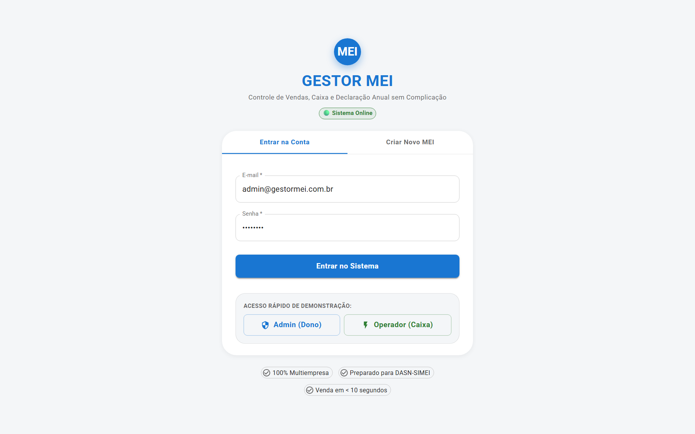
*Figura 01 — Tela de Login e Acesso Seguro ao Gestor MEI.*

### Componentes Explicados da Tela de Login:

| Elemento Visual | Como Funciona | Para Que Serve? |
| :--- | :--- | :--- |
| **1. Logo e Marca do Sistema** | Identificação visual do Gestor MEI com subdomínio seguro. | Confirma que você está no ambiente oficial e seguro. |
| **2. Campo "E-mail"** | Digite o seu endereço de e-mail cadastrado (ex: `admin@gestormei.com.br`). | Identifica o seu usuário no sistema. |
| **3. Campo "Senha"** | Digite a sua senha secreta de acesso. | Protege seus dados contra acessos não autorizados. Os caracteres aparecem mascarados por segurança. |
| **4. Botão "Entrar"** | Clique ou toque após preencher seus dados. | Valida suas credenciais e redireciona imediatamente ao seu Dashboard. |
| **5. Ícone de Tema (Lua/Sol)** | Localizado no canto superior direito. | Permite ligar o tema noturno antes mesmo de fazer o login. |

> [!TIP]
> **Dica de Segurança:** Nunca anote sua senha em papéis visíveis no balcão de atendimento. Se precisar que seu atendente registre vendas, crie um usuário específico para ele com o perfil **Operador de Caixa**. Assim, ele não terá acesso a configurações nem relatórios sigilosos.

---

## 3. Módulo 02 — Dashboard Inteligente & Centro de Controle MEI

O **Dashboard Inteligente** é o "painel de bordo" do seu negócio. Sempre que você entrar no sistema, esta será a primeira tela a ser exibida. Nela, você vê em poucos segundos tudo o que aconteceu hoje e o que precisa da sua atenção.

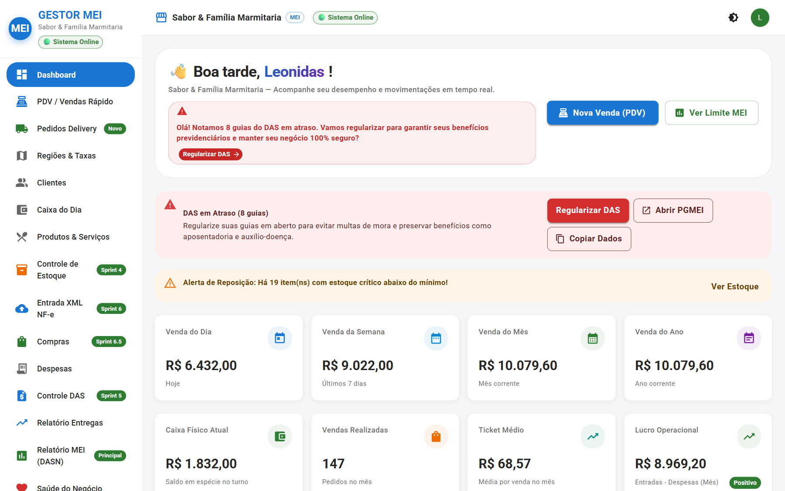
*Figura 02 — Dashboard Inteligente com saudações humanas, métricas do dia, saúde do negócio e alertas do DAS.*

### Componentes Explicados do Dashboard:

| Elemento Visual | Como Funciona | O Que Significa para o MEI? |
| :--- | :--- | :--- |
| **1. Saudação Personalizada** | Mensagem calorosa no topo: *"Bom dia, Leonidas Paulino!"* com a data completa e frase motivacional. | Torna o trabalho mais humano e confirma quem está operando o sistema. |
| **2. Card "Vendas Hoje"** | Exibe o total faturado no dia em reais e o número de pedidos finalizados. | Permite acompanhar em tempo real se o movimento do dia está atingindo a meta. |
| **3. Card "Faturamento Anual"** | Mostra o total acumulado no ano e o **Termômetro do Limite MEI** (teto de R$ 81.000,00). | **Sua blindagem fiscal!** Evita ser pego de surpresa pelo desenquadramento da Receita Federal. |
| **4. Card "Saúde do Negócio"** | Mostra o percentual de saúde operacional com base no caixa, estoque e guias em dia. | Dá uma nota resumida de como está a gestão geral da empresa. |
| **5. Card de Alertas do DAS** | Alerta visual colorido: <br>• 🟢 **Verde:** Guias em dia.<br>• 🟡 **Amarelo:** Vence em até 7 dias.<br>• 🔴 **Vermelho:** Guia em atraso! | Lembra você do vencimento do DAS (dia 20) para não pagar juros nem multas. |
| **6. Botões de Ação do DAS** | Botões rápidos para **"Abrir PGMEI Oficial"**, **"Ver Guia"** ou **"Copiar Dados"**. | Abre diretamente o portal da Receita Federal sem você precisar caçar o link no Google. |
| **7. Alerta de Estoque Crítico** | Lista os produtos que atingiram a quantidade mínima de segurança. | Evita perder vendas por falta de mercadoria na prateleira ou na cozinha. |
| **8. Ações Rápidas de Topo** | Atalhos com 1 clique para "Abrir PDV", "Novo Cliente", "Dar Entrada de Nota" e "Ver Relatório". | Economiza cliques na correria do balcão. |

---

## 4. Módulo 03 — Gestão de Clientes e Histórico

No comércio de bairro, pizzaria, lanchonete, oficina ou salão, conhecer o cliente pelo nome é o maior segredo da fidelização. A tela de **Clientes** permite cadastrar e consultar qualquer pessoa em poucos segundos.

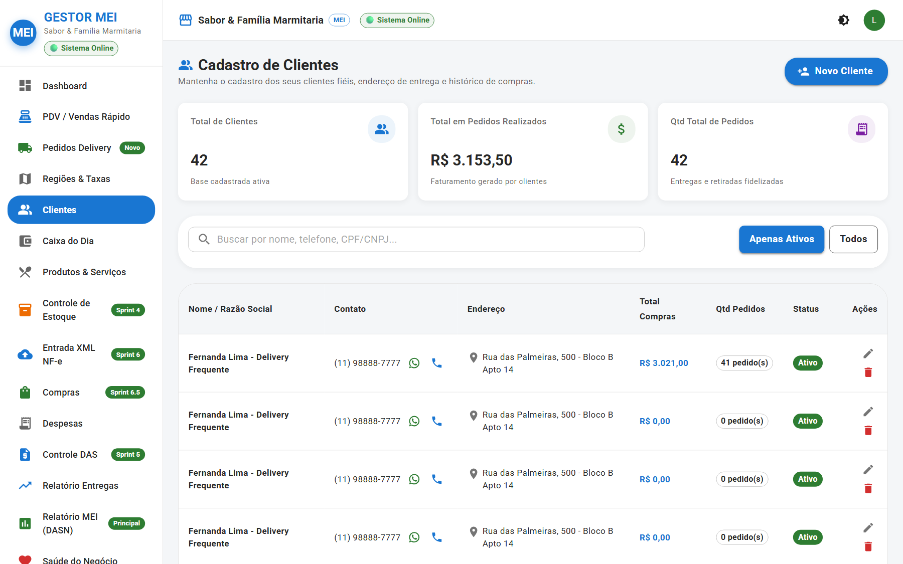
*Figura 03 — Tela de Clientes com busca em tempo real, regiões e contatos.*

### Componentes Explicados da Tela de Clientes:

| Elemento Visual | Como Funciona | Para Que Serve? |
| :--- | :--- | :--- |
| **1. Campo de Busca Instantânea** | Digite qualquer parte do nome, número de telefone ou CPF do cliente. | A tabela filtra na hora enquanto você digita, sem recarregar a página. |
| **2. Botão "+ Novo Cliente"** | Botão azul destacado no canto superior direito. | Abre o formulário limpo para cadastrar um novo cliente. |
| **3. Tabela de Clientes** | Colunas organizadas: *Nome*, *Telefone/WhatsApp*, *Endereço*, *Bairro/Região* e *Ações*. | Exibe todo o seu livro de clientes em uma única lista organizada. |
| **4. Vínculo de Região de Entrega** | Mostra a qual região (ex: *Centro*, *Zona Sul*) o cliente pertence. | Quando fizer um pedido de entrega, o sistema já sabe o valor da taxa do motoboy! |
| **5. Botões de Ação na Linha** | Ícones de lápis (Editar) e lixeira (Excluir com confirmação). | Permite atualizar o telefone, trocar o endereço ou remover um cadastro antigo. |

---

## 5. Módulo 04 — Catálogo de Produtos e Serviços

Aqui você cadastra tudo o que a sua empresa vende, desde marmitas, lanches e refrigerantes até cortes de cabelo, consultorias ou manutenções.

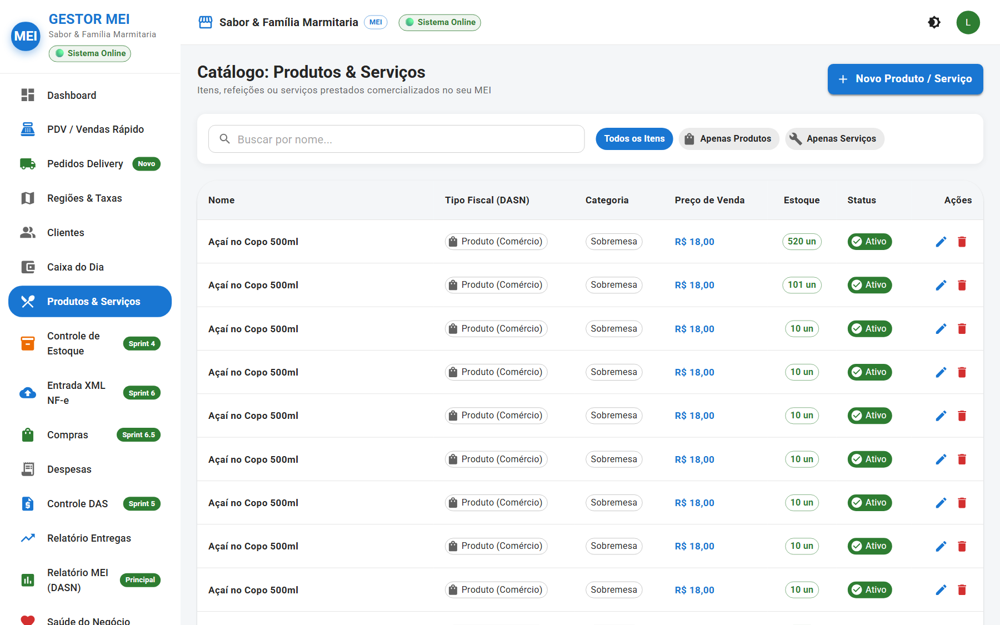
*Figura 04 — Catálogo de Produtos e Serviços com preços de venda, custos e margem.*

### Componentes Explicados de Produtos & Serviços:

| Elemento Visual | Como Funciona | Por Que É Crucial para o MEI? |
| :--- | :--- | :--- |
| **1. Seletor de Tipo (Produto vs Serviço)** | Opção de marcar se o item é **Mercadoria/Produto** ou **Serviço**. | **Regra Fiscal de Ouro!** Na Declaração Anual do MEI (DASN), a Receita exige saber quanto você faturou com Comércio e quanto faturou com Serviços. O sistema faz essa conta sozinho! |
| **2. Preço de Venda** | O valor em reais que o cliente paga no balcão. | Usado no PDV e na soma automática do total das vendas. |
| **3. Custo Unitário** | O valor que você pagou para comprar ou produzir aquele item. | Permite que o sistema calcule o seu **Lucro Bruto** exato em cada produto vendido. |
| **4. Estoque Mínimo** | Quantidade de segurança recomendada (ex: 5 unidades). | Quando o saldo baixar desse número, o sistema avisa você imediatamente no Dashboard. |
| **5. Botão "+ Adicionar Produto"** | Abre a janela para novo cadastro com código SKU ou de barras opcional. | Agiliza a inserção de novos itens no cardápio ou na vitrine. |

---

## 6. Módulo 05 — Controle de Estoque & Movimentações

Acabou a época do caderninho rasurado e das surpresas no estoque! A tela de **Estoque** garante que você saiba exatamente o que tem no depósito ou na despensa.

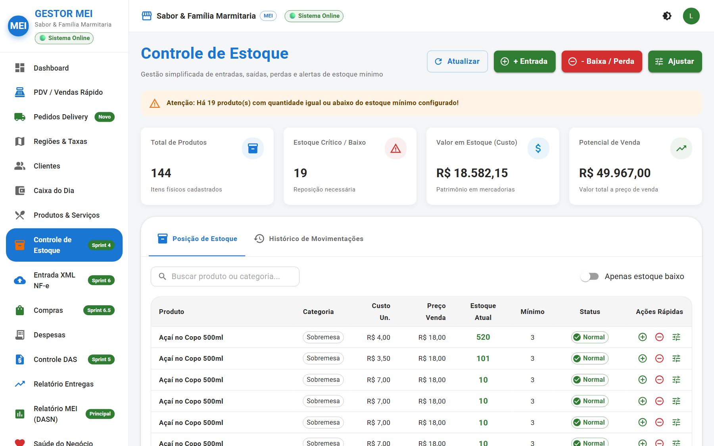
*Figura 05 — Painel de Controle de Estoque com indicadores de custo total e saldo físico.*

### Componentes Explicados do Controle de Estoque:

| Elemento Visual | Como Funciona | O Que Isso Facilita? |
| :--- | :--- | :--- |
| **1. Cards de Resumo no Topo** | 4 blocos informativos: <br>• **Total de Itens Cadastrados**<br>• **Saldo Físico Geral (Unidades)**<br>• **Valor do Estoque em Dinheiro (R$)**<br>• **Produtos com Saldo Baixo** | Mostra quanto do seu capital de giro está parado na prateleira em formato de mercadoria. |
| **2. Tabela de Saldos com Semáforo** | Cada item exibe uma cor: <br>• 🟢 **Normal:** Saldo confortável.<br>• 🟡 **Atenção:** Perto do mínimo.<br>• 🔴 **Crítico:** Abaixo do mínimo ou zerado! | Em uma rápida olhada, você já sabe exatamente o que precisa comprar hoje. |
| **3. Botão "Entrada Manual"** | Registra compras rápidas na feira ou atacado sem nota fiscal. | Aumenta o saldo do produto e atualiza o histórico de compras. |
| **4. Botão "Saída por Perda/Avaria"** | Registra produtos que venceram, quebraram ou foram consumidos internamente. | Mantém o estoque alinhado com a realidade física sem desorganizar as vendas. |
| **5. Botão "Ajuste de Inventário"** | Permite forçar o saldo correto após uma contagem física no final do mês. | Zera diferenças e registra o motivo da correção para auditoria. |

---

## 7. Módulo 06 — Módulo de Compras & Histórico de Notas

Toda vez que você importa uma nota fiscal de fornecedor (XML NF-e), ela é transformada automaticamente em uma **Compra Registrada**. Aqui você acompanha tudo o que comprou, de quem comprou e quanto gastou.

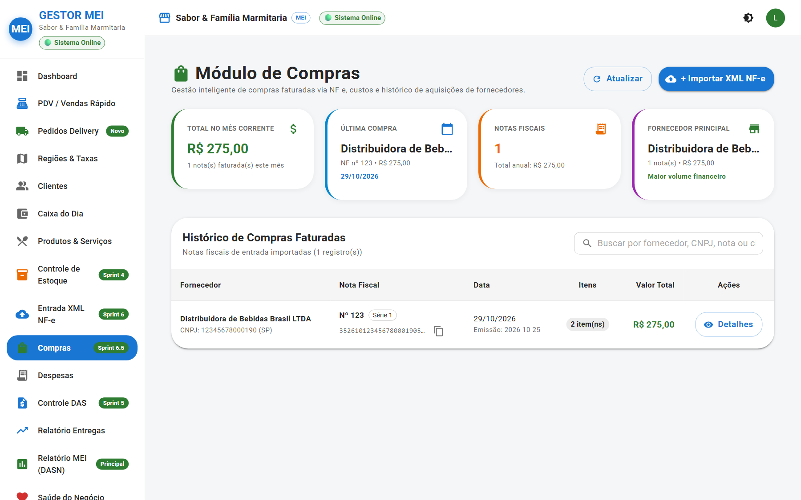
*Figura 06 — Módulo de Compras com métricas de gastos mensais e fornecedor principal.*

### Componentes Explicados do Módulo de Compras:

| Elemento Visual | Como Funciona | Benefício Direto para o MEI |
| :--- | :--- | :--- |
| **1. Card "Última Compra"** | Informa a data e o valor da compra mais recente registrada. | Mantém a rotina de reposição sempre visível. |
| **2. Card "Total Comprado no Mês"** | Soma automática de todas as notas fiscais de entrada do mês corrente. | Evita comprar mais do que a sua capacidade de pagamento mensal. |
| **3. Card "Notas Importadas"** | Contagem exata de notas fiscais recebidas no período. | Facilita a prestação de contas com seu consultor ou contador. |
| **4. Card "Fornecedor Principal"** | Destaca a empresa onde você mais gastou dinheiro. | Te dá argumentos para negociar melhores prazos e descontos por volume! |
| **5. Tabela Histórica de Compras** | Colunas: *Fornecedor*, *Chave / Número da Nota*, *Data da Nota*, *Qtd Itens* e *Valor Total*. | Histórico permanente e à prova de perda para consultar notas antigas. |
| **6. Botão "Detalhes da Compra"** | Abre uma janela exibindo cada produto daquela nota fiscal, com preço e unidade. | Permite auditar se o fornecedor cobrou o preço combinado. |

---

## 8. Módulo 07 — Entrada Automática de Estoque via XML NF-e

A importação automática de XML é um dos recursos mais poderosos do Gestor MEI. Em vez de passar horas digitando item por item que chegou na nota, você apenas solta o arquivo XML e o sistema faz o resto!

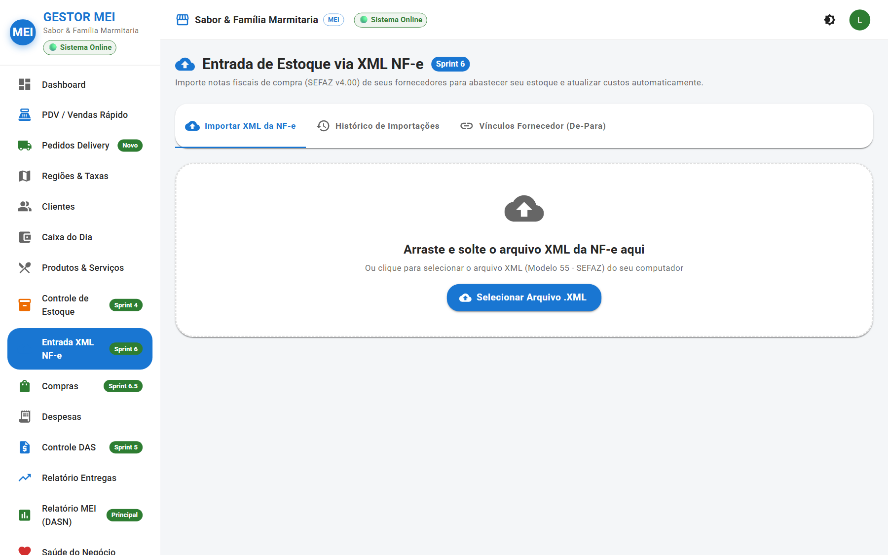
*Figura 07 — Área de Upload do XML com pré-visualização, associação de itens e trava anti-duplicidade.*

### Passo a Passo para Dar Entrada em Notas Fiscais:

1. **Passo 1 — Carregar o Arquivo:** Arraste o arquivo `.xml` enviado pelo seu fornecedor para a caixa tracejada ou clique em **"Selecionar Arquivo XML"**. (Se preferir, cole o texto do XML na caixa de texto).
2. **Passo 2 — Análise e Pré-visualização:** O sistema lê a chave oficial de 44 dígitos, o nome do fornecedor, o CNPJ e todos os itens da nota.
3. **Passo 3 — Associação Inteligente (De-Para):** O sistema compara o produto da nota com os produtos já cadastrados no seu estoque. Se o nome for parecido, ele já sugere o vínculo automaticamente!
4. **Passo 4 — Fator de Conversão:**
   > **Exemplo Prático:** Se o fornecedor emitiu `1 Caixa de Refrigerante (CX)` e dentro dela vêm `12 unidades`, você simplesmente informa o fator **12**. O sistema dará entrada em **12 latas no seu estoque** e calculará o custo unitário dividindo o preço da caixa por 12!
5. **Passo 5 — Concluir Entrada:** Clique no botão azul **"Importar Estoque"**. Pronto! O saldo aumentou, o custo foi recalculado e o histórico de compras foi gerado.

> [!IMPORTANT]
> **Trava Anti-Duplicidade Ativa:** Se você tentar importar a mesma nota fiscal de novo por engano, o Gestor MEI bloqueia imediatamente avisando: *"Esta nota fiscal já foi importada anteriormente no dia XX/XX"*. Seu estoque nunca fica duplicado!

---

## 9. Módulo 08 — Controle DAS Mensal (Obrigações do MEI)

O pagamento do DAS (Documento de Arrecadação do Simples Nacional) é a obrigação mais importante do microempreendedor. É ele que garante a sua aposentadoria, auxílio-doença, salário-maternidade e mantém seu CNPJ limpo e sem dívidas na Receita Federal.

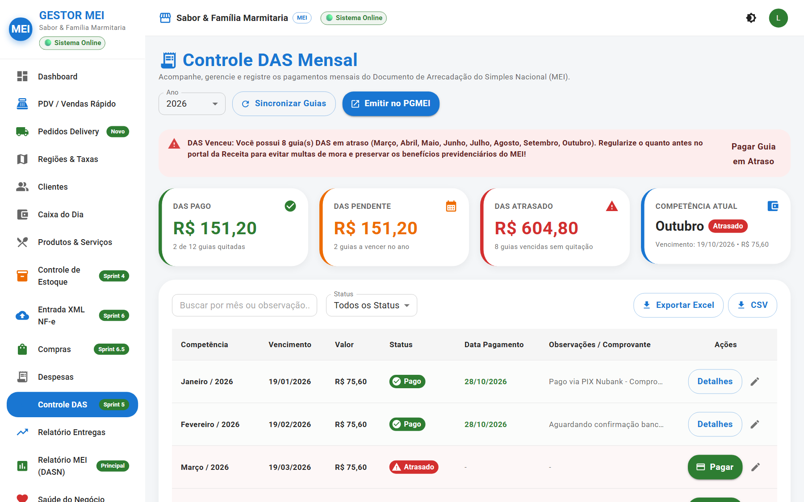
*Figura 08 — Controle das 12 guias anuais do DAS com status, vencimento e quitação.*

### Componentes Explicados do Controle DAS:

| Elemento Visual | Como Funciona | O Que Evita? |
| :--- | :--- | :--- |
| **1. Cards com Status das Guias** | 4 caixas de destaque: <br>• 🟢 **Pagas:** Quantas guias você já quitou no ano.<br>• 🟡 **Pendentes:** Guias futuras que ainda vão vencer.<br>• 🔴 **Atrasadas:** Guias que passaram do dia 20 sem pagar.<br>• 💰 **Total Pago:** Valor acumulado quitado. | Evita surpresas desagradáveis com multas e juros diários da Receita Federal. |
| **2. Tabela dos 12 Meses do Ano** | Linhas de Janeiro a Dezembro exibindo a competência, valor estimado (R$ 75 a R$ 85), data de vencimento e status atual. | Dá uma visão de 1 ano inteiro em uma única tela. |
| **3. Botão "Registrar Pagamento"** | Ao pagar no banco ou aplicativo, clique neste botão e informe a data em que pagou e o código de autenticação bancária. | O sistema marca a guia com o selo verde **PAGO** e grava o comprovante no histórico. |
| **4. Botão "Emitir no PGMEI"** | Atalho oficial que abre o site da Receita Federal em nova aba. | Poupa tempo: você não precisa digitar seu CNPJ no Google toda vez que for emitir a guia do mês. |

---

## 10. Módulo 09 — Relatório Anual do MEI (DASN-SIMEI)

Todo início de ano (até 31 de maio), todo MEI precisa enviar a sua Declaração Anual de Faturamento. Muitos microempreendedores pagam caro para alguém fazer isso porque não sabem onde somar os valores. Com o Gestor MEI, essa tela entrega a declaração pronta!

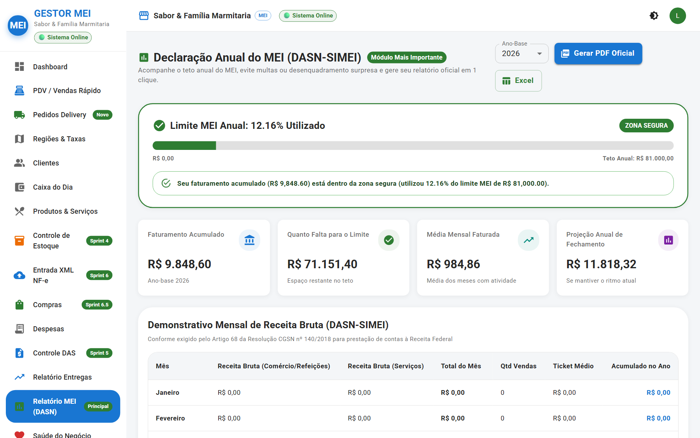
*Figura 09 — Relatório Fiscal Anual com separação entre Comércio e Serviços e termômetro dos R$ 81.000,00.*

### Como Usar o Relatório na Declaração Anual:

1. **Termômetro do Teto (R$ 81.000,00):** Acompanhe a barra de progresso. Enquanto estiver verde, seu negócio está com faturamento 100% dentro do limite do MEI.
2. **Segregação Obrigatória:**
   - **Receita Bruta com Comércio / Produtos:** Valor exato que deve ser colado no primeiro campo da declaração oficial do governo.
   - **Receita Bruta com Serviços:** Valor exato que deve ser colado no segundo campo da declaração oficial.
3. **Exportação em 1 Clique:**
   - Clique em **"Exportar PDF"** para salvar ou imprimir o relatório com cabeçalho oficial e data.
   - Guarde este documento junto aos seus comprovantes fiscais (a lei exige guardar por 5 anos).

---

## 11. Módulo 10 — Pedidos Delivery & Despacho de Balcão

Para quem trabalha com entregas de marmitas, lanches, peças, presentes ou produtos diversos, o módulo de **Delivery** organiza os pedidos em uma esteira ágil de produção.

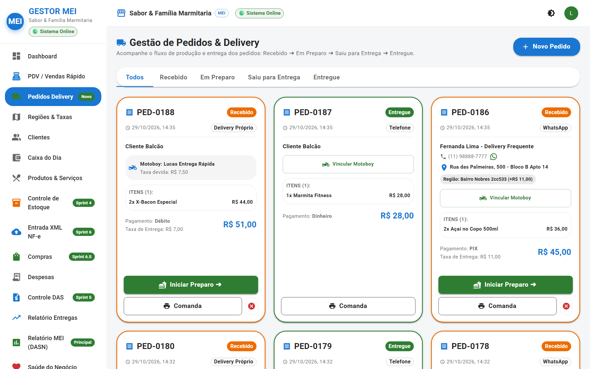
*Figura 10 — Painel de Pedidos Delivery em colunas de status (Pendente, Preparo, Em Rota, Entregue).*

### Fluxo Operacional de um Pedido de Entrega:

```
[ NOVO PEDIDO ] ──▶ [ EM PREPARO ] ──▶ [ SAIU PARA ENTREGA ] ──▶ [ ENTREGUE ]
(Calcula taxa)     (Imprime comanda)    (Atribui motoboy)        (Liquida no caixa)
```

1. **Recebimento do Pedido:** O pedido entra na coluna *Pendente*.
2. **Cálculo da Taxa:** Ao escolher o cliente cadastrado, o sistema preenche sozinho o endereço e o valor exato da taxa de entrega daquela região.
3. **Impressão da Comanda Térmica:** Toque em **"Imprimir Comanda"**. O sistema envia para a sua impressora térmica de cupom (58mm ou 80mm) com layout limpo: cabeçalho com telefone, itens pedidos, observações sem cebola/sem maionese, troco para quanto e endereço de entrega.
4. **Despacho com Motoboy:** Ao passar o pedido para o entregador, mude o status para *Saiu para Entrega* e selecione qual motoboy está levando.
5. **Conclusão:** Quando o motoboy voltar, marque como *Entregue*. O valor entra imediatamente no seu Caixa do Dia!

---

## 12. Módulo 11 — Gestão de Motoboys e Acertos do Dia

Evite discussões no fim da noite sobre "quantas entregas cada motoboy fez" ou "quanto tem que pagar para cada um".

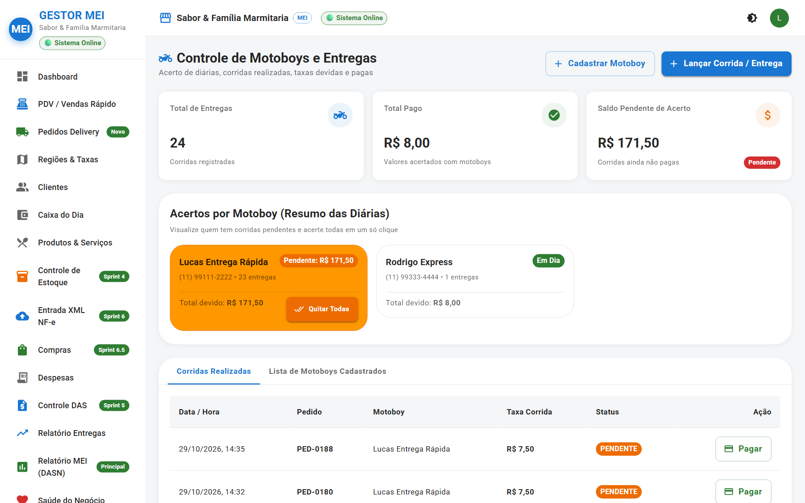
*Figura 11 — Cadastro de Entregadores, taxas combinadas e acerto de diárias.*

### Componentes Explicados do Módulo Motoboys:

| Elemento Visual | Como Funciona | Para Que Serve? |
| :--- | :--- | :--- |
| **1. Botão "+ Novo Motoboy"** | Cadastro rápido com nome, celular, modelo e placa da moto. | Mantém o registro de contato de toda a equipe de entrega. |
| **2. Tipo de Acerto** | Escolha se o motoboy recebe **Diária Fixa**, **Taxa Fixa por Entrega** ou **Taxa da Região**. | O sistema faz a conta matemática sozinho a cada pedido concluído. |
| **3. Extrato de Corridas do Dia** | Lista detalhada de todos os pedidos levados por aquele motoboy durante o expediente. | Transparência total entre o dono do negócio e o entregador parceiro. |
| **4. Botão "Realizar Fechamento"** | Mostra o valor total a ser pago ao entregador no final do turno. | Agiliza o acerto de contas sem papel de rascunho nem erros de cálculo. |

---

## 13. Módulo 12 — Painel do Consultor LPTI Tech (Auditoria e Diagnóstico)

O **Painel do Consultor** é uma inovação exclusiva criada para que consultores de negócios da LPTI Tech, mentores do Sebrae ou contadores parceiros possam acompanhar a saúde da sua empresa sem atrapalhar a sua rotina de vendas.

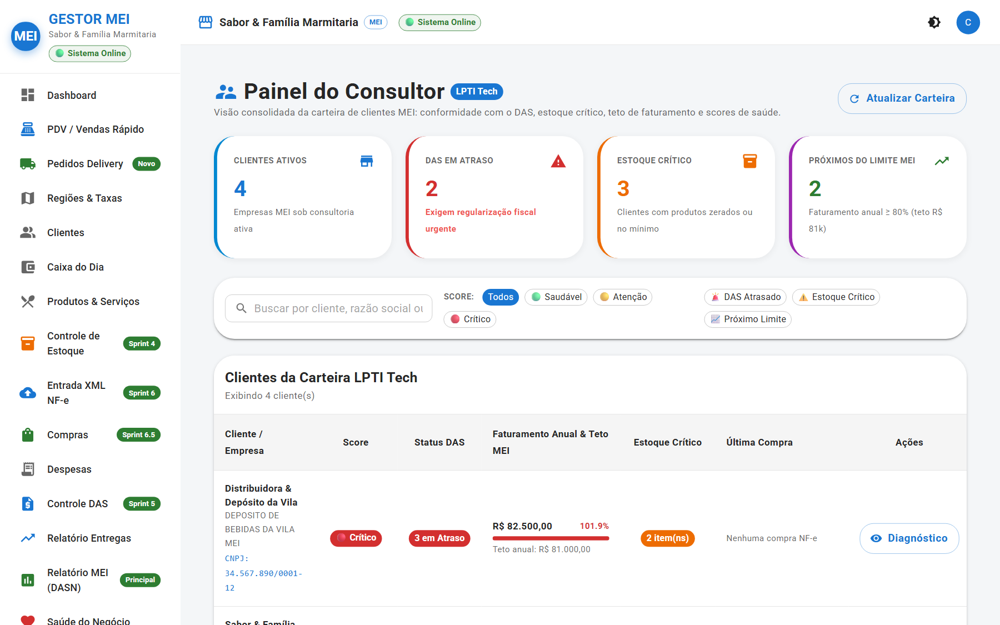
*Figura 12 — Painel Panorâmico do Consultor com KPIs consolidados, scores semáforo e diagnósticos.*

### O Sistema de Semáforo de Saúde:

O sistema avalia 3 pilares vitais e classifica cada negócio em um score de cor:

- 🟢 **Saudável:** Faturamento anual abaixo de 80% do teto, guias do DAS rigorosamente em dia e estoque sem rupturas críticas.
- 🟡 **Atenção:** Negócio faturou entre 80% e 99% do limite anual, ou possui guias vencendo em até 7 dias, ou itens essenciais com estoque em nível mínimo.
- 🔴 **Crítico:** Guia DAS com mais de 30 dias de atraso, faturamento ultrapassando os R$ 81.000,00 (risco iminente de desenquadramento) ou produtos principais zerados.

### Componentes do Painel do Consultor:

1. **4 KPIs Panorâmicos de Topo:** Total de Clientes Ativos na carteira, quantos estão com DAS em Atraso, quantos estão com Estoque Crítico e quantos estão Próximos do Limite MEI.
2. **Filtros de Auditoria em 1 Clique:** O consultor pode clicar nos botões rápidos para ver somente as empresas com problemas urgentes a resolver.
3. **Modal de Diagnóstico Estratégico:** Ao clicar em **"Diagnóstico"** na linha de um cliente, o sistema gera recomendações táticas sob medida para o MEI: quando renegociar compras, como planejar a transição para Microempresa (ME) ou como regularizar guias pendentes.

---

## 14. Módulo 13 — Configurações Gerais, Dados do MEI e Módulos

Nesta tela, o administrador ajusta a identidade da empresa e pode ligar ou desligar recursos conforme a necessidade do seu segmento.

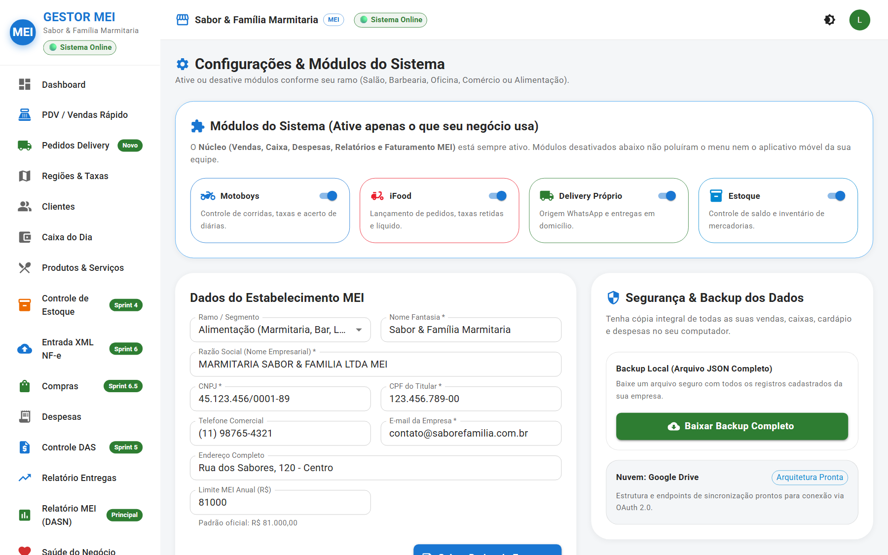
*Figura 13 — Tela de Configurações, parâmetros fiscais e interruptores de módulos opcionais.*

### Componentes Explicados de Configurações:

| Elemento Visual | Como Funciona | Por Que É Útil? |
| :--- | :--- | :--- |
| **1. Dados da Empresa** | Campos para Nome Fantasia, Razão Social, CNPJ, Inscrição Municipal, Endereço e Telefone. | Esses dados saem impressos automaticamente no cabeçalho das comandas térmicas e relatórios. |
| **2. Interruptor "Módulo de Motoboys"** | Chave liga/desliga. | Se você não faz entregas (ex: uma barbearia ou loja física), desative para sumir com o menu de motoboys e deixar a tela ainda mais limpa! |
| **3. Interruptor "Módulo iFood / Delivery"** | Chave liga/desliga. | Ativa ou oculta a gestão de taxas e regiões de entrega. |
| **4. Gestão da Equipe (Usuários)** | Permite convidar outros operadores e definir quem é *Administrador* e quem é *Operador de Caixa*. | Controle total de quem pode ver o quê no sistema. |

---

## 15. Perguntas Frequentes (FAQ)

### 1. O que acontece se eu esquecer de pagar o DAS no dia 20?
O Gestor MEI mudará imediatamente o status da guia daquele mês para o selo vermelho **"Atrasado"** e exibirá um alerta em destaque no topo do seu Dashboard. Basta clicar no botão **"Abrir PGMEI"** para emitir a guia com a correção monetária e, após o pagamento, registrar a quitação no sistema.

### 2. Como o Gestor MEI sabe se estou perto de estourar o limite anual?
O sistema monitora todas as suas vendas de balcão e de delivery registradas ao longo do ano civil (1º de janeiro a 31 de dezembro) e compara em tempo real com o teto oficial do MEI de **R$ 81.000,00**. Quando você atinge 80% desse valor, o termômetro fica amarelo para que você possa se planejar com o seu consultor.

### 3. Posso usar o sistema em um celular ou tablet antigo?
**Sim!** O frontend do Gestor MEI foi construído em tecnologia web moderna e totalmente responsiva. Ele roda suavemente em navegadores de celular (Google Chrome, Safari, Edge) em qualquer smartphone, tablet ou computador simples de balcão.

### 4. Preciso instalar algum aplicativo pesado no meu computador?
**Não!** O sistema é 100% online (nuvem). Você pode acessá-lo digitando o endereço no navegador de qualquer dispositivo, bastando informar seu e-mail e senha.

### 5. O operador de caixa pode ver o faturamento anual da minha empresa?
**Não!** Os usuários cadastrados com o perfil **Operador de Caixa** só têm permissão para abrir/fechar caixa, lançar vendas, cadastrar clientes e imprimir comandas. Telas sigilosas como Relatório MEI, Configurações e Painel do Consultor são bloqueadas para operadores.

### 6. Como funciona o "Fechamento Cego" de caixa?
No final do expediente, o operador não vê na tela quanto dinheiro deveria ter na gaveta. Ele precisa contar fisicamente as cédulas e moedas e digitar o valor que tem em mãos. Só após ele confirmar é que o sistema compara com as vendas registradas e mostra se houve sobra ou falta de dinheiro. Isso elimina fraudes e esquecimentos no balcão!

### 7. O que acontece se a internet cair enquanto estou atendendo?
O sistema armazena a sua sessão no navegador. Se a internet oscilar momentaneamente por alguns segundos, os dados em tela continuam visíveis. Assim que a conexão for restabelecida, o sistema sincroniza as novas requisições com o banco de dados em nuvem.

### 8. Como o sistema lida quando o fornecedor vende em fardo ou caixa e eu vendo em unidade?
Na tela de **Entrada XML NF-e**, o sistema possui o campo **Fator de Conversão**. Se você comprou `1 CX` com `24 unidades`, basta digitar `24`. O sistema entrará com 24 unidades no saldo e dividirá o valor da caixa por 24 para registrar o custo unitário exato de cada item.

### 9. O sistema emite Nota Fiscal Eletrônica (NFe/NFCe) direto para a SEFAZ?
Nesta versão v1.4.0, o sistema realiza a **leitura e importação de XMLs de notas recebidas de fornecedores (modelo 55)** e prepara toda a base fiscal para o fechamento anual da Receita Federal. A emissão de notas fiscais pelo sistema está planejada para sprints futuras, conforme os padrões fiscais de cada estado.

### 10. Como enviar meus dados anuais para a Receita Federal?
Vá até o menu **Relatório MEI (DASN)**, confira os valores já calculados e separados entre *Comércio* e *Serviços*, clique em **"Exportar PDF"** para guardar uma cópia e preencha os mesmos números no portal oficial do SIMEI da Receita Federal. Leva menos de 3 minutos!

---

## 16. Glossário Ilustrado de Termos MEI

- **DAS (Documento de Arrecadação do Simples Nacional):** Guia única mensal paga pelo MEI que inclui INSS (previdência), ICMS (se comércio) e/ou ISS (se prestador de serviço). Vence impreterivelmente todo dia 20.
- **DASN-SIMEI:** Declaração Anual Simplificada para o Microempreendedor Individual. Relatório anual obrigatório entregue até o fim de maio informando todo o faturamento bruto do ano anterior.
- **Termômetro MEI:** Indicador gráfico do sistema que mostra quanto você faturou no ano em relação ao limite de R$ 81.000,00 (ou proporcional no primeiro ano de CNPJ).
- **XML NF-e:** Arquivo digital oficial emitido pelo seu fornecedor que contém todos os dados da nota fiscal eletrônica (modelo 55).
- **Chave de Acesso:** Número único composto por 44 dígitos que identifica qualquer nota fiscal eletrônica emitida no Brasil.
- **De-Para (Associação de Produtos):** Processo inteligente em que o sistema associa o nome estranho que o fornecedor colocou na nota ao produto com o nome comercial que você cadastrou no seu cardápio ou prateleira.
- **Fator de Conversão:** Multiplicador que transforma embalagens coletivas (fardos, caixas, engradados) em unidades individuais para controle de estoque correto.
- **Fechamento Cego:** Método de auditoria de caixa onde o funcionário declara os valores físicos sem saber o saldo do sistema, evitando desvios ou manipulação de números.
- **Sangria de Caixa:** Retirada pontual de dinheiro da gaveta do caixa durante o dia (para guardar no cofre, pagar uma despesa urgente ou evitar excesso de notas no balcão).
- **Suprimento de Caixa (Fundo de Troco):** Valor em dinheiro colocado na gaveta no início do dia para ter moedas e notas miúdas para dar troco aos primeiros clientes.
- **Margem de Contribuição:** Diferença entre o preço de venda e o custo do produto. É o valor que sobra de cada venda para pagar os custos fixos da empresa e gerar lucro.
- **Estoque Mínimo:** Quantidade mínima que você deve ter de um item antes de fazer um novo pedido ao fornecedor, evitando ficar sem o produto.
- **RBAC (Role-Based Access Control):** Controle de segurança do sistema que libera telas diferentes dependendo se o usuário é Administrador, Operador de Caixa ou Consultor.
- **PGMEI:** Portal oficial na internet da Receita Federal do Brasil onde são gerados os boletos do DAS.

---

## 17. Suporte Técnico e Contatos LPTI Tech

Sempre que precisar de ajuda, tirar dúvidas ou solicitar melhorias, a equipe técnica e consultiva da LPTI Tech está à sua inteira disposição:

- **E-mail de Suporte:** `suporte@lptitech.com.br`
- **Atendimento Consultivo:** `consultoria@lptitech.com.br`
- **Portal do Sistema:** `https://gestor-mei.vercel.app`
- **Documentação do Sistema:** Consulte também o arquivo central [`GESTOR_MEI_DOCUMENTACAO_COMPLETA.md`](file:///c:/Users/LeonidasPaulino/Downloads/gestor-mei-main/gestor-mei-main/GESTOR_MEI_DOCUMENTACAO_COMPLETA.md) e o guia de infraestrutura [`DEPLOY_BETA.md`](file:///c:/Users/LeonidasPaulino/Downloads/gestor-mei-main/gestor-mei-main/DEPLOY_BETA.md).

---

> *Gestor MEI — Gestão simples, rápida e inteligente para o microempreendedor que move o Brasil.*

