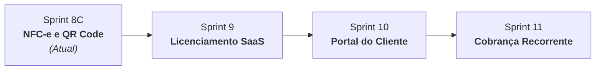

# 📊 Estado Oficial do Projeto — GESTOR MEI

> [!IMPORTANT]
> **REGRA DE MANUTENÇÃO CONTÍNUA:**
> Este documento reflete o estado oficial, homologado e em tempo real do **Gestor MEI**. Sempre que uma sprint, módulo ou marco de desenvolvimento for concluído, o assistente Antigravity deve atualizar este arquivo automaticamente antes de encerrar o ciclo de tarefas.

---

## 🏢 Identificação do Projeto

- **Empresa Mantenedora:** LPTI Tech
- **Produto:** GESTOR MEI
- **Versão Atual:** `1.6.1` (Design System Sentinel - Fases 1, 2 e 3 Homologadas)
- **Tipo de Aplicação:** SaaS Multiempresa B2B (Foco em MEIs e Pequenos Negócios)

---

## 🚀 Sprints Concluídas e Homologadas (100% Funcionais)

| Sprint | Versão | Escopo Entregue | Status |
| :--- | :---: | :--- | :---: |
| **Sprint 1** | `1.0.0` | **Núcleo SaaS Essencial:** Autenticação JWT, Dashboard Executivo, Catálogo de Produtos e Serviços, PDV Rápido (<10s), Controle de Caixa com Fechamento Cego, Despesas e Relatório Anual DASN-SIMEI (Teto de R$ 81.000,00). | Homologado |
| **Sprint 2** | `1.0.5` | **Carrinho Relacional & Clientes:** Vendas 1:N com múltiplos itens, cadastro de clientes com integração WhatsApp e cálculo automático de totais. | Homologado |
| **Sprint 3** | `1.0.8` | **Logística & Delivery:** Regiões e taxas de entrega, Kanban operacional de pedidos (*Recebido $\to$ Preparo $\to$ Em Rota $\to$ Entregue*), vinculação de motoboys e impressão térmica ESC/POS. | Homologado |
| **Sprint 4** | `1.1.0` | **Controle de Estoque & Custos:** Kardex de movimentações (Entrada, Saída, Ajuste, Perda), alerta de estoque mínimo no Dashboard e atualização de custo de reposição. | Homologado |
| **Sprint 5** | `1.2.0` | **Controle DAS Mensal:** Gerenciamento das 12 guias anuais do MEI, marcação de liquidação, alertas de vencimento (crítico/atenção) e atalho para o portal PGMEI. | Homologado |
| **Sprint 6** | `1.2.5` | **Entrada XML NF-e:** Parser SEFAZ v4.00, memória De-Para de códigos de fornecedores, conversão automática de embalagens e entrada no estoque. | Homologado |
| **Sprint 6.5**| `1.3.0` | **Gestão de Compras & Fornecedores:** Dashboard analítico de compras, detalhamento de custos unitários e relação de fornecedores parceiros. | Homologado |
| **Sprint 7** | `1.4.0` | **Painel do Consultor LPTI Tech:** Perfil `CONSULTOR`, visão multi-carteira, termômetro de saúde do negócio (Saudável, Atenção, Crítico) e parecer consultivo. | Homologado |
| **Sprint 8A/8B**| `1.4.0` | **Compra Manual & RBAC Estrito:** Lançamento de compras sem NF-e, upload de comprovantes, cadastro inline de produtos e blindagem de segurança para operadores. | Homologado |
| **Sprint 8.5.1**| `1.4.0` | **Refinamento Visual Executivo:** Logo ampliada em 30% no login, hierarquia visual sem vazios, ampliação da Sidebar para 280px com alinhamento vertical balanceado (Logo, GESTOR MEI, ERP). | Homologado |
| **Sprint UX 1 a 5** | `1.4.5` | **Design System Executivo:** Modernização completa de Dashboard, Estoque, Clientes, Produtos e PDV. | Homologado |
| **Sprint Security 1** | `1.4.7` | **Hardening Integral de Segurança:** Seed controlado, validação estrita de SECRET_KEY, remoção de CORS wildcard, Rate Limiting SlowAPI em login e recuperação de senha. | Homologado |
| **Sprint UX 6 a 9** | `1.5.0` | **Sentinel Foundation & Modernização Total:** Componentes oficiais `FiscalShieldCapsule`, `VitalityRing`, `ProtectiveCard`, `ClearSignalKPI`, modernização de Consultor, Controle DAS e Relatório MEI. | Homologado |
| **Cloudflare R2** | `1.5.1` | **Storage Híbrido Zero Egress:** Provedor Cloudflare R2 com fallback local transparente, particionamento por tenant e suporte a comprovantes e XMLs. | Homologado |
| **Sprint 8C.0** | `1.5.2` | **Estudo Técnico NFC-e SEFAZ MG:** Estudo regulatório e arquitetural aprovado para modelo 65. (Sprint 8C.1 adiada para foco operacional). | Homologado |
| **Sprint Operação Real 1** | `1.6.0` | **Prontidão Operacional de Piloto com Cliente Real:** 1. **Produtos com Imagem:** Upload, conversão automática para WebP via Pillow (LANCZOS e EXIF transpose), persistência híbrida Cloudflare R2 / local, avatar 44px na tabela e modal com preview e remoção. 2. **Logotipo Oficial da Empresa:** Upload de logotipo institucional, WebP 90% (máx 600x600), Cloudflare R2 / local, exibição na Sidebar, Topbar, Configurações e pronto para DANFE/Relatórios fiscais. 3. **PDV Visual:** Catálogo com fotos dos produtos e placeholder Sentinel elegante, busca rápida integrada e thumbnails visuais no carrinho de compras. 4. **Validação Operacional:** 32 testes unitários e de integração passando (100%), build de frontend e backend aprovados sem regressões. | Homologado |
| **Sprint Sentinel Fase 1**| `1.6.1` | **Design System Sentinel (Fase 1):** Modernização executiva do Dashboard MASTER (`Layout.tsx`, `DashboardGreeting.tsx`), `Usuários & Equipe` (`Usuarios.tsx`) e criação do pacote de componentes base `frontend/src/design-system/` (`SentinelCard`, `SentinelTable`, `SentinelBadge`, `SentinelInput`). Distinção visual MASTER (#040D1A) vs OWNER (#020617), números tabulares (`tnum`), densidade operacional 13px e 100% de integridade funcional. Homologação visual autônoma via Playwright MCP. | Homologado |
| **Sprint Sentinel Fase 2**| `1.6.1` | **Design System Sentinel (Fase 2):** Modernização executiva dos módulos de Governança Multiempresa MASTER (`PainelConsultor.tsx`), Catálogo de Produtos & Serviços (`Produtos.tsx`) e Controle de Estoque & Kardex (`Estoque.tsx`). Aplicação dos componentes `SentinelCard`, `SentinelTable`, `SentinelBadge` e `SentinelInput`, números tabulares (`tnum`) e densidade 13px. Homologação visual autônoma via Playwright MCP. | Homologado |
| **Sprint Sentinel Fase 3**| `1.6.1` | **Design System Sentinel (Fase 3):** Expansão do padrão Sentinel para a cadeia de suprimentos: Módulo de Compras Faturadas (`Compras.tsx`), Entrada Manual de Mercadorias (`NovaCompraManual.tsx`), Entrada de Estoque via XML NF-e (`ImportarNfe.tsx`) e Detalhes da Compra (`DetalheCompra.tsx`). Aplicação de `SentinelCard`, `SentinelTable`, `SentinelBadge`, `SentinelInput`, números tabulares (`tnum`), superfícies encastradas e densidade 13px. PDV e Caixa rigorosamente preservados fora do escopo. Homologação visual autônoma via Playwright MCP. | Homologado |

---

## 🎯 Próximos Passos no Roadmap

1. **Sprint Operação Real 2 / Piloto em Produção:**
   - Validação com cliente real piloto no ambiente de homologação/produção.
2. **Sprint 8C.1 — Emissão NFC-e e QR Code:**
   - Homologação SEFAZ-MG modelo 65.
3. **OAuth Google & Microsoft (Descoberta Concluída):**
   - Autenticação social para OWNER e CONSULTOR.
4. **Sprint 9 — Licenciamento SaaS:**
   - Planos comerciais (START, DELIVERY PRO, FULL MEI).

---

## 🗺️ Backlog Aprovado

1. **Sprint 9 — Licenciamento SaaS:**
   - Planos comerciais: **START** (R$ 39,90), **DELIVERY PRO** (R$ 59,90) e **FULL MEI** (R$ 89,90).
   - Gestão automatizada de ciclo de vida: `TRIAL` (14 dias), `ATIVA`, `SUSPENSA` (somente leitura) e `CANCELADA`.
   - Período de carência de 5 dias corridos pós-vencimento (Grace Period) e suspensão no 6º dia.
2. **Sprint 10 — Portal do Cliente:**
   - Cardápio/catálogo digital público para clientes finais realizarem pedidos online pelo navegador ou celular.
   - Consulta de status de entrega e 2ª via de comprovantes/XMLs.
3. **Sprint 11 — Cobrança Recorrente:**
   - Integração com gateway Asaas para emissão automática de PIX e boletos recorrentes.
   - Geração de QR Code PIX dinâmico na tela do PDV com conciliação automática.

---

## 🛠️ Skills Instaladas no Antigravity

| Skill | Escopo de Atuação | Localização no Repositório |
| :--- | :--- | :--- |
| **`gestor-mei-core`** | Identidade oficial LPTI Tech, stack, módulos homologados e arquitetura. | [`.agents/skills/gestor-mei-core/`](file:///c:/Users/LeonidasPaulino/Desktop/gestor-mei-main/.agents/skills/gestor-mei-core/) |
| **`gestor-mei-ui-system`** | Sistema de design executivo padrão Stripe/Asaas, eliminando layouts genéricos. | [`.agents/skills/gestor-mei-ui-system/`](file:///c:/Users/LeonidasPaulino/Desktop/gestor-mei-main/.agents/skills/gestor-mei-ui-system/) |
| **`gestor-mei-rbac`** | Blindagem das regras de acesso (MASTER, OWNER, CONSULTOR e OPERATOR). | [`.agents/skills/gestor-mei-rbac/`](file:///c:/Users/LeonidasPaulino/Desktop/gestor-mei-main/.agents/skills/gestor-mei-rbac/) |
| **`gestor-mei-saas`** | Arquitetura de monetização, planos e ciclo de licenças da Sprint 9. | [`.agents/skills/gestor-mei-saas/`](file:///c:/Users/LeonidasPaulino/Desktop/gestor-mei-main/.agents/skills/gestor-mei-saas/) |
| **`lpti-brand-guidelines`** | Proteção da propriedade intelectual: Gestor MEI (Produto) e LPTI Tech (Desenvolvedora). | [`.agents/skills/lpti-brand-guidelines/`](file:///c:/Users/LeonidasPaulino/Desktop/gestor-mei-main/.agents/skills/lpti-brand-guidelines/) |
| **`gestor-mei-playwright`** | Automação e homologação autônoma de jornadas e fluxos via Playwright MCP. | [`.agents/skills/gestor-mei-playwright/`](file:///c:/Users/LeonidasPaulino/Desktop/gestor-mei-main/.agents/skills/gestor-mei-playwright/) |

---

## 🔌 MCPs (Model Context Protocol) Planejados & Disponíveis

1. **Playwright MCP:**
   - *Status:* ✅ **Playwright MCP instalado, ativo e homologado** (`@playwright/mcp` v1.66.0 via Stdio JSON-RPC 2.0).
   - *Função:* Execução autônoma de jornadas de ponta a ponta (E2E), snapshots da árvore de acessibilidade, captura de screenshots de evidência, auditoria de interações e navegação real sem necessidade de scripts manuais `.spec.ts`.
2. **Google Developer Knowledge:**
   - *Status:* ✅ **Google Developer Knowledge MCP instalado e ativo** (`antigravity-plugins-official/plugin/google-developer-knowledge` v1.0.2).
   - *Função:* Consulta de documentação técnica oficial, grounding de APIs (Google Cloud, Gemini, Firebase, Android e Web.dev) e skill `retrieving-developer-knowledge`.
3. **Chrome DevTools:**
   - *Status:* ✅ **Chrome DevTools MCP instalado, ativo e validado** (`chrome-devtools-mcp` v1.12.0 em `mcp_config.json`).
   - *Função:* Inspeção visual de DOM, CSS cascade, acessibilidade (WCAG), métricas Core Web Vitals (LCP) e auditorias de performance no Google Chrome.
4. **GitHub MCP:**
   - *Status:* ✅ **GitHub MCP conectado e validado** (endpoint oficial `https://api.githubcopilot.com/mcp/` autenticado como `LPTI-Tech` para o repositório `LPTI-Tech/gestor-mei`).
   - *Função:* Automação de branches, pull requests, revisões e commits diretamente pelo assistente.

---

## 🌐 Infraestrutura & URLs Oficiais

### Ambientes de Produção (Nuvem)
- **Frontend (Vercel):** `https://gestor-mei.vercel.app` *(ou domínio oficial `https://gestormei.com.br`)*
- **Backend (Render):** `https://gestor-mei-api.onrender.com`
- **Armazenamento de Objetos (Cloudflare R2):** Endpoint compatível S3 com Zero Egress Fees e particionamento multi-tenant (`empresas/{id}/produtos/`, `empresas/{id}/logo/`, `empresas/{id}/comprovantes/`).
- **Banco de Dados (Neon):** PostgreSQL 16 Serverless com pool de conexões e SSL obrigatório.

### Ambiente Local de Desenvolvimento
- **Frontend (Vite):** [http://localhost:5173](http://localhost:5173)
- **Backend (FastAPI / Uvicorn):** [http://localhost:8001](http://localhost:8001)
- **Swagger / OpenAPI (Local):** [http://localhost:8001/docs](http://localhost:8001/docs)
- **Banco Local:** SQLite (`gestor_mei.db`) com migrações automáticas no startup.
