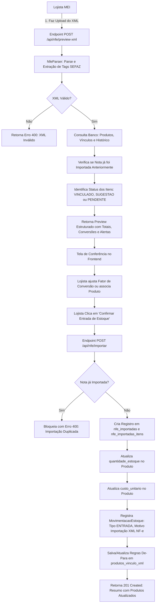

# 📋 Documentação Técnica da Sprint 6 — Importação de XML NF-e (Fases 1 e 2)

> **Versão do Documento:** 1.2.0  
> **Sistema:** Gestor MEI — Sistema de Gestão Empresarial para Microempreendedores Individuais  
> **Módulo:** Controle de Estoque & Entrada de Mercadorias por XML de NF-e  
> **Data:** Outubro de 2026  
> **Status:** Fases 1 e 2 Concluídas — Arquitetura, Parser, Vínculos De-Para, Efetivação de Entrada e Histórico  

---

## 1. Visão Geral e Contexto

No cotidiano de um Microempreendedor Individual (MEI) do ramo de alimentação ou comércio (lanchonetes, padarias, mercadinhos, docerias, hamburguerias), uma das tarefas mais demoradas e suscetíveis a erro humano é o **lançamento manual de compras e reposição de estoque**.

A cada compra com fornecedores e distribuidores, o fornecedor emite uma **Nota Fiscal Eletrônica (NF-e, Modelo 55)** e envia o arquivo XML. O MEI precisa:
1. Digitar item por item no sistema;
2. Atualizar a quantidade em estoque;
3. Atualizar o custo unitário pago pelo item;
4. Realizar cálculos mentais de conversão de unidades (por exemplo: comprar 2 caixas de refrigerante com 12 latas e dar entrada em 24 unidades avulsas).

A **Sprint 6 do Gestor MEI** introduz o **Módulo de Importação Inteligente de XML NF-e**, permitindo que o lojista faça o upload do XML da nota de compra e, com poucos cliques, vincule os itens do fornecedor aos produtos locais, converta as unidades de medida e lance automaticamente as movimentações de estoque.

---

## 2. Princípios e Diretrizes Técnicas

### 2.1. O que ESTÁ no Escopo da Sprint 6
- **Entrada de Mercadorias (Compras de Fornecedores):** Foco exclusivo na importação de notas recebidas pelo MEI.
- **Parsing de XML NF-e Padrão SEFAZ (v4.00):** Leitura das tags oficiais `<infNFe>`, `<ide>`, `<emit>`, `<dest>`, `<det>`, `<prod>`, `<total>`.
- **Tabela de Vínculo De-Para (`ProdutoVinculoXML`):** Memorização inteligente da associação entre o código do produto no fornecedor (`cProd`) e o produto no Gestor MEI (`produto_id`).
- **Fator de Conversão de Unidades:** Conversão de unidades comerciais (caixa, fardo, pacote) para unidades de controle de estoque (unidade, grama, ml).
- **Pré-visualização (Preview):** Tela de conferência prévia onde o lojista valida valores, quantidades e vínculos antes de efetivar qualquer alteração no banco de dados.
- **Efetivação Automática de Estoque (`POST /api/nfe/importar`):** Atualização automática dos saldos físicos e custos unitários no catálogo de produtos.
- **Rastreabilidade e Movimentações:** Geração de movimentações em lote do tipo `ENTRADA` e motivo `Importação XML NF-e`, registrando os dados do fornecedor e chave de acesso da nota.
- **Histórico de Notas Fiscais Importadas (`nfe_importadas` e `nfe_importadas_itens`):** Consulta ao histórico de compras com detalhamento de cada item.
- **Prevenção de Importação em Duplicidade:** Bloqueio garantido por `UniqueConstraint` e validação prévia na API para a mesma chave de acesso.

### 2.2. O que NÃO ESTÁ no Escopo (Restrições Expressas)
- ❌ **Não implementar emissão fiscal de notas** (NFC-e ou NFS-e de saída).
- ❌ **Não integrar com web services da SEFAZ** (sem certificados digitais A1/A3, sem consultas a webservices estaduais ou distribuição DFe).
- ❌ **Sem complexidade tributária desnecessária para MEI** (MEI é isento de apuração de créditos de ICMS, PIS e COFINS na entrada, não necessitando de escrituração SPED).

---

## 3. Mapeamento das Tags XML (SEFAZ v4.00)

| Grupo XML | Tag SEFAZ | Descrição no XML | Campo Mapeado no Gestor MEI |
| :--- | :--- | :--- | :--- |
| **Identificação** | `<infNFe Id="NFe...">` | Chave de Acesso (44 dígitos) | `chave_acesso` |
| `<ide>` | `<nNF>` | Número da Nota Fiscal | `numero_nota` |
| `<ide>` | `<serie>` | Série da Nota Fiscal | `serie` |
| `<ide>` | `<dhEmi>` | Data e hora de emissão | `data_emissao` |
| **Emitente** | `<emit>/<CNPJ>` | CNPJ do Fornecedor | `fornecedor_cnpj` |
| `<emit>` | `<xNome>` | Razão Social do Fornecedor | `fornecedor_nome` |
| `<emit>` | `<xFant>` | Nome Fantasia do Fornecedor | `fornecedor_fantasia` |
| `<emit>` | `<UF>` | Estado do Fornecedor | `fornecedor_uf` |
| **Destinatário** | `<dest>/<CNPJ>` | CNPJ do Destinatário | `destinatario_cnpj` (validação com MEI) |
| **Itens** | `<det nItem="1">` | Número de ordem do item | `numero_item` |
| `<prod>` | `<cProd>` | Código do item no fornecedor | `codigo_fornecedor` |
| `<prod>` | `<cEAN>` | Código de barras GTIN/EAN | `ean_fornecedor` |
| `<prod>` | `<xProd>` | Descrição do produto na nota | `descricao_fornecedor` |
| `<prod>` | `<NCM>` | Nomenclatura Comum do Mercosul | `ncm` |
| `<prod>` | `<CFOP>` | Código Fiscal de Operação | `cfop` |
| `<prod>` | `<uCom>` | Unidade de comercialização (CX, UN) | `unidade_comercial` |
| `<prod>` | `<qCom>` | Quantidade faturada | `quantidade_comercial` |
| `<prod>` | `<vUnCom>` | Valor unitário na nota | `valor_unitario` |
| `<prod>` | `<vProd>` | Valor total do item | `valor_total` |
| **Totais** | `<ICMSTot>/<vNF>` | Valor total da nota fiscal | `valor_total_nota` |

---

## 4. Arquitetura e Fluxo de Dados Completo



---

## 5. Modelagem de Dados

### 5.1. `ProdutoVinculoXML` (`produtos_vinculo_xml`)
Armazena as regras de vinculação De-Para entre o fornecedor e o catálogo local para que compras subsequentes sejam reconhecidas automaticamente.

```python
class ProdutoVinculoXML(Base):
    __tablename__ = "produtos_vinculo_xml"

    id = Column(Integer, primary_key=True, index=True)
    empresa_id = Column(Integer, ForeignKey("empresas.id"), nullable=False, index=True)
    fornecedor_cnpj = Column(String(20), nullable=False, index=True)
    fornecedor_nome = Column(String(200), nullable=True)
    codigo_fornecedor = Column(String(100), nullable=False, index=True)  # cProd da NF-e
    descricao_fornecedor = Column(String(255), nullable=True)           # xProd da NF-e
    ean_fornecedor = Column(String(20), nullable=True)                  # cEAN da NF-e
    produto_id = Column(Integer, ForeignKey("produtos.id"), nullable=False, index=True)
    fator_conversao = Column(Float, default=1.0, nullable=False)        # ex: 1 cx = 12 un
    created_at = Column(DateTime, default=datetime.utcnow)
    updated_at = Column(DateTime, default=datetime.utcnow, onupdate=datetime.utcnow)

    __table_args__ = (
        UniqueConstraint("empresa_id", "fornecedor_cnpj", "codigo_fornecedor", name="uq_empresa_fornecedor_cprod"),
    )
```

### 5.2. `NfeImportada` (`nfe_importadas`)
Registra o histórico de cabeçalho de todas as notas fiscais importadas pela empresa.

```python
class NfeImportada(Base):
    __tablename__ = "nfe_importadas"

    id = Column(Integer, primary_key=True, index=True)
    empresa_id = Column(Integer, ForeignKey("empresas.id"), nullable=False, index=True)
    chave_acesso = Column(String(44), nullable=False, index=True)
    numero_nota = Column(String(20), nullable=False)
    serie = Column(String(10), nullable=False, default="1")
    data_emissao = Column(String(30), nullable=True)
    valor_total = Column(Float, nullable=False, default=0.0)
    fornecedor_cnpj = Column(String(20), nullable=False, index=True)
    fornecedor_nome = Column(String(200), nullable=False)
    fornecedor_uf = Column(String(2), nullable=True)
    total_itens = Column(Integer, nullable=False, default=0)
    usuario_id = Column(Integer, ForeignKey("users.id"), nullable=True)
    data_importacao = Column(DateTime, default=datetime.utcnow, nullable=False)
    observacao = Column(Text, nullable=True)

    __table_args__ = (
        UniqueConstraint("empresa_id", "chave_acesso", name="uq_empresa_nfe_chave"),
    )
```

### 5.3. `ItemNfeImportada` (`nfe_importadas_itens`)
Armazena o detalhamento de cada item que compôs a nota importada.

```python
class ItemNfeImportada(Base):
    __tablename__ = "nfe_importadas_itens"

    id = Column(Integer, primary_key=True, index=True)
    nfe_importada_id = Column(Integer, ForeignKey("nfe_importadas.id"), nullable=False, index=True)
    produto_id = Column(Integer, ForeignKey("produtos.id"), nullable=False, index=True)
    codigo_fornecedor = Column(String(100), nullable=False)
    descricao_fornecedor = Column(String(255), nullable=True)
    unidade_comercial = Column(String(20), nullable=True, default="UN")
    quantidade_comercial = Column(Float, nullable=False, default=0.0)
    fator_conversao = Column(Float, default=1.0, nullable=False)
    quantidade_entrada = Column(Float, nullable=False, default=0.0)
    valor_unitario_nota = Column(Float, nullable=False, default=0.0)
    custo_unitario_calculado = Column(Float, nullable=False, default=0.0)
    valor_total = Column(Float, nullable=False, default=0.0)
```

---

## 6. Especificação das APIs

### 6.1. `POST /api/nfe/preview-xml`
- **Descrição:** Recebe um arquivo `.xml` ou texto XML, faz o parsing, verifica se já foi importado anteriormente, mapeia com os vínculos existentes e retorna a conferência prévia.
- **Autenticação:** Bearer Token JWT.

### 6.2. `POST /api/nfe/importar` (Fase 2)
- **Descrição:** Efetiva a entrada de estoque em lote a partir dos itens validados no preview.
- **Comportamentos:**
  1. Verifica unicidade da `chave_acesso` na empresa. Lança `400 Bad Request` se já existir.
  2. Registra a nota em `nfe_importadas` e seus itens em `nfe_importadas_itens`.
  3. Incrementa `quantidade_estoque` no produto ($\text{quantidade} \times \text{fator}$).
  4. Atualiza `custo_unitario` do produto ($\frac{\text{valor\_unitario}}{\text{fator}}$).
  5. Insere registro em `movimentacoes_estoque` com `tipo="ENTRADA"` e `motivo="Importação XML NF-e"`.
  6. Atualiza ou cria vínculos em `produtos_vinculo_xml`.

### 6.3. `GET /api/nfe/historico`
- **Descrição:** Lista o histórico de notas fiscais importadas pela empresa em ordem cronológica decrescente.

### 6.4. `GET /api/nfe/historico/{id}`
- **Descrição:** Retorna os detalhes completos de uma NF-e importada e a lista dos seus itens com quantidades e valores faturados.

### 6.5. `GET /api/nfe/vinculos` & `POST /api/nfe/vinculos` & `DELETE /api/nfe/vinculos/{id}`
- **Descrição:** Endpoints de gestão direta das regras de De-Para e fatores de conversão.

---

## 7. Cronograma e Status da Sprint 6

| Fase | Escopo | Status |
| :--- | :--- | :--- |
| **Fase 1** | Arquitetura, Modelagem `ProdutoVinculoXML`, Parser XML SEFAZ, APIs de Preview e De-Para | ✅ **Concluída** |
| **Fase 2** | Endpoint `POST /api/nfe/importar`, atualização automática de estoque/custo, tabela `nfe_importadas`, prevenção de duplicidade e histórico | ✅ **Concluída** |
| **Fase 3** | Interface Web Frontend (Tela `/nfe` com Drag-and-Drop, Preview, De-Para visual, Ajuste de Fator, Histórico e Criação Rápida de Produtos) | ✅ **Concluída** |
| **Fase 4** | Homologação final com arquivos XML reais de fornecedores e testes ponta a ponta | ⏳ Próxima Fase |
