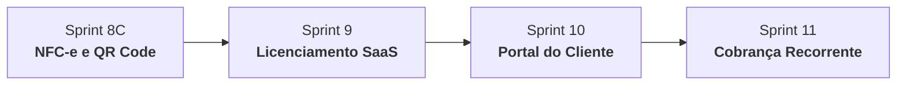

# Gestor MEI — Core Specification & Official Manual

Este documento consolida o conhecimento oficial de arquitetura, domínio, papéis, regras de negócio inegociáveis e roadmap do **GESTOR MEI**, produto SaaS proprietário desenvolvido pela **LPTI Tech**.

O objetivo primordial desta Skill é atuar como a fonte da verdade arquitetural para qualquer agente, desenvolvedor ou mantenedor do sistema.

---

## 🏢 1. Identificação Corporativa & Produto

- **Empresa Mantenedora:** LPTI Tech
- **Produto:** GESTOR MEI
- **Posicionamento:** ERP inteligente, moderno e descomplicado focado em Microempreendedores Individuais (MEIs) e pequenos negócios (alimentação, comércio local e prestação de serviços).
- **Proposta de Valor:** Centralizar a gestão operacional (vendas, caixa, estoque, delivery) com a inteligência contábil-fiscal (controle do teto MEI de R$ 81.000,00, emissão de DASN e guias DAS).

---

## 💻 2. Stack Tecnológica Oficial

| Camada | Tecnologia | Detalhes & Bibliotecas |
| :--- | :--- | :--- |
| **Frontend** | React 18 + TypeScript | Vite, Material-UI (MUI v5), Recharts, Axios, Lucide Icons |
| **Backend** | Python 3.10+ / FastAPI | Uvicorn, SQLAlchemy 2.0, Pydantic v2, Python-Jose (JWT), Passlib (Bcrypt) |
| **Banco de Dados** | PostgreSQL (Neon Serverless) | Suporte adicional a SQLite local para desenvolvimento zero-config |
| **Infraestrutura** | Vercel (Frontend) + Render (Backend) | CI/CD automatizado, SSL nativo, CORS restritivo multi-ambiente |

---

## 🏛️ 3. Arquitetura do Sistema

1. **SaaS Multiempresa (Multi-tenant):**
   - Cada empresa possui seus dados estritamente isolados através do identificador `empresa_id` em todas as tabelas operacionais e relacionais.
   - Nenhuma query ou mutação pode ser executada sem a cláusula de escopo da empresa do usuário autenticado.
2. **Controle de Acesso Baseado em Papéis (RBAC):**
   - Hierarquia estrita com 4 perfis fundamentais: `MASTER`, `OWNER`, `CONSULTOR` e `OPERATOR`.
3. **Licenciamento SaaS:**
   - Controle de status da conta da empresa (`ativa`, `degustacao`, `bloqueada`, `cancelada`), vigência de planos e feature flags modulares.
4. **Painel do Consultor (Multi-carteira):**
   - O Consultor LPTI Tech possui visão consolidada das empresas sob sua responsabilidade contábil/estratégica sem misturar credenciais.

---

## 👥 4. Perfis de Acesso & RBAC

| Perfil | Escopo | Descrição das Permissões |
| :--- | :--- | :--- |
| **MASTER** | Plataforma Global | Administrador supremo da infraestrutura LPTI Tech. Gerencia empresas, emite licenças e cria contas de `OWNER`. |
| **OWNER** | Empresa Própria | Proprietário legal do MEI. Gestão total da sua empresa: configura módulos, cria e gerencia contas de `OPERATOR`, acessa todo o financeiro e relatórios fiscais. |
| **CONSULTOR** | Carteira Vinculada | Consultor contábil/financeiro associado a uma ou mais empresas. Acessa relatórios fiscais, relatórios MEI, compras e diagnósticos de saúde sem poder gerenciar credenciais operacionais. |
| **OPERATOR** | Caixa / Balcão | Operador de frente de caixa e expedição. Realiza vendas no PDV, gerencia pedidos delivery e cadastra clientes rápidos. **Não possui acesso ao financeiro nem configurações**. |

---

## ⛔ 5. Regras Inegociáveis de Negócio & Governança

1. **`MASTER` cria Empresa:** Nenhuma empresa pode ser provisionada sem validação e comando direto do perfil `MASTER`.
2. **`MASTER` cria `OWNER`:** A atribuição de um proprietário (`OWNER`) a uma empresa é prerrogativa do `MASTER` da LPTI Tech.
3. **`OWNER` cria `OPERATOR`:** Apenas o proprietário da empresa pode convidar, ativar, editar ou desativar os operadores da sua equipe.
4. **`CONSULTOR` vinculado por Empresa:** O acesso de um consultor é concedido estritamente através do vínculo formal `empresa_id` $\leftrightarrow$ `consultor_id`.
5. **`OPERATOR` não visualiza Financeiro:** O operador de caixa é estritamente proibido de visualizar:
   - Faturamento global consolidado
   - Margens de lucro e markups
   - Telas de Despesas, Relatório MEI (DASN), Controle DAS e Saúde do Negócio
   - Relatórios executivos de lucratividade
6. **Teto Fiscal MEI (R$ 81.000,00):** Todas as projeções e alertas de faturamento anual respeitam a legislação brasileira do SIMEI, com sinalização de tolerância de até 20% (R$ 97.200,00) para desenquadramento.

---

## 📦 6. Módulos Homologados (Status: 100% Funcionais)

1. **PDV (Ponto de Venda Rápido):** Abertura/fechamento de vendas, leitor de código de barras, múltiplos meios de pagamento (Dinheiro, PIX, Cartão Débito/Crédito) e cálculo de troco.
2. **Delivery & Pedidos:** Gestão de pedidos para viagem e entrega com taxas por região geográfica configurável.
3. **Caixa do Dia:** Abertura de turno, suprimento (fundo de caixa), sangria (retirada de dinheiro) e conciliação de fechamento de caixa por operador.
4. **Clientes:** Cadastro de clientes com histórico de compras, ticket médio, telefones e endereços para entrega.
5. **Produtos & Serviços:** Gestão de catálogo com preço de custo, preço de venda, código de barras, categoria e controle de fracionamento.
6. **Controle de Estoque:** Kardex de movimentações (entrada, saída, perda, ajuste manual) e alerta de estoque mínimo configurável.
7. **Entrada XML NF-e:** Importação de arquivos XML de fornecedores com conciliação automática de novos produtos e atualização de custos de estoque.
8. **Compra Manual:** Registro detalhado de notas de compras avulsas e compras diretas em atacados.
9. **Controle DAS:** Gerenciamento do status de pagamento das guias mensais do Documento de Arrecadação do Simples Nacional (DAS-MEI).
10. **Relatório MEI (DASN-SIMEI):** Apuração fiscal oficial separada por revenda de mercadorias (comércio) e prestação de serviços.
11. **Saúde do Negócio:** Termômetro analítico com índice de liquidez, lucratividade, ponto de equilíbrio e proximidade do teto MEI.
12. **Painel do Consultor:** Módulo de auditoria fiscal e contábil com alternância rápida entre clientes atribuídos ao consultor.

---

## 🗺️ 7. Roadmap Oficial de Evolução

- **Sprint 8C — NFC-e e QR Code:**
  - Emissão de Nota Fiscal de Consumidor Eletrônica integrada via SEFAZ.
  - Geração de QR Code padrão Danfe NFC-e para impressão térmica (ESC/POS 58mm/80mm).
- **Sprint 9 — Licenciamento SaaS:**
  - Mecanismo automatizado de ativação/renovação de planos (Mensal, Trimestral, Anual).
  - Bloqueio inteligente por inadimplência com período de carência (Grace Period) e modo somente-leitura.
- **Sprint 10 — Portal do Cliente:**
  - Área externa de autoatendimento onde clientes finais consultam cardápio digital, status de pedidos e 2ª via de comprovantes.
- **Sprint 11 — Cobrança Recorrente:**
  - Integração nativa com gateways de cobrança (Asaas / Mercado Pago) para mensalidades das licenças e split de pagamento.

---

## 📚 Documentos de Referência
- [Matriz Completa de Permissões RBAC](./references/rbac-matrix.md)
- [Arquitetura & Infraestrutura (Vercel, Render, Neon)](./references/architecture.md)
- [Especificação Detalhada dos 12 Módulos Homologados](./references/modules-catalog.md)
- [Detalhamento do Roadmap (Sprints 8C a 11)](./references/roadmap.md)
- [Metadados Estruturados em JSON](./resources/project-metadata.json)
