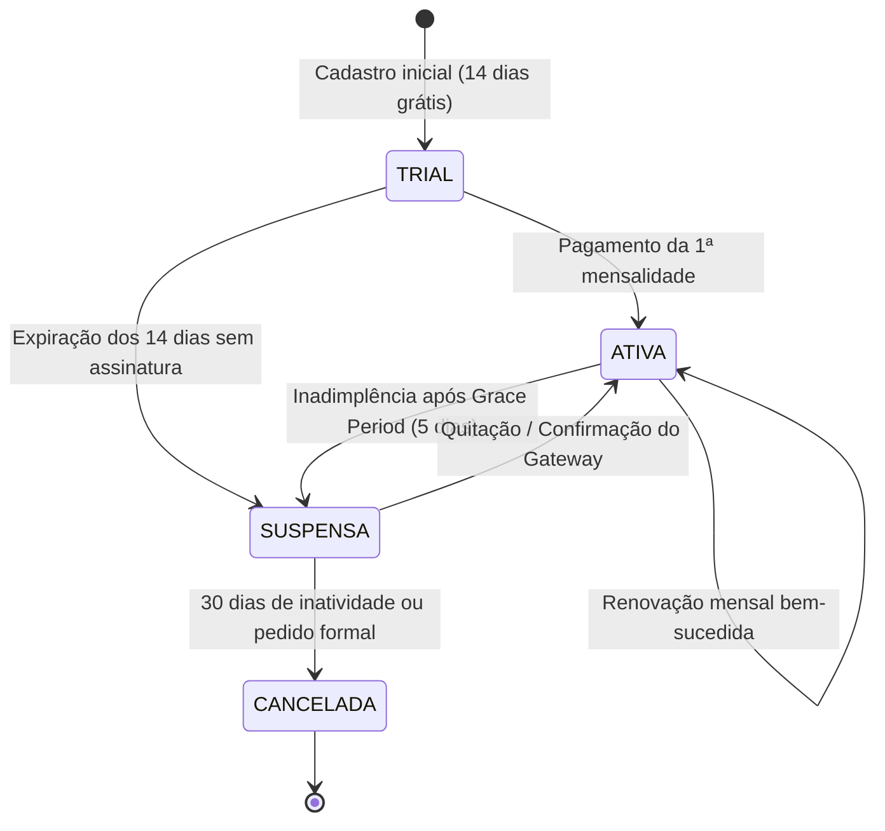

# Gestor MEI — SaaS Licensing Architecture (Sprint 9 Preparation)

Este documento estabelece a especificação canônica do modelo de licenciamento SaaS (Software as a Service) do **GESTOR MEI**, desenhado pela **LPTI Tech** para ser implementado na **Sprint 9**.

---

## 💎 1. Estrutura de Planos Comerciais

A plataforma oferece 3 níveis de assinatura adaptados ao estágio de maturidade do microempreendedor:

| Plano | Foco do MEI | Módulos Liberados | Limitações |
| :--- | :--- | :--- | :--- |
| **START** | Pequeno Comércio & Balcão | PDV Balcão, Caixa do Dia, Cadastro de Clientes, Catálogo de Produtos, Estoque Básico, DAS e Relatório MEI (DASN). | 1 Operador simultâneo. Sem delivery/motoboy. Sem importação XML NF-e. |
| **DELIVERY PRO**| Marmitarias, Lanchonetes e Entregas | Todos os recursos do plano START + Pedidos Delivery, Regiões & Taxas de Entrega, Módulo Motoboys e Módulo iFood. | Até 3 Operadores. Sem importação XML NF-e. |
| **FULL MEI** | Gestão Total & Alta Performance | Todos os recursos do DELIVERY PRO + Entrada XML NF-e, Compra Manual, Saúde do Negócio com BI Avançado, Consultoria Multi-carteira e Suporte Prioritário LPTI Tech. | Operadores ilimitados. Acesso total a todas as ferramentas homologadas. |

---

## 🔄 2. Estados da Licença (Status Lifecycle)



### 1. `TRIAL` (Período de Degustação)
- Duração: 14 dias corridos a partir do provisionamento da empresa.
- Todos os recursos do plano **FULL MEI** liberados para demonstração de valor.
- Banner discreto no topo indicando dias restantes de teste gratuito.

### 2. `ATIVA` (Operação Regular)
- Pagamento em dia. Todos os módulos do plano contratado 100% operacionais.

### 3. `SUSPENSA` (Modo Somente Leitura / Read-Only)
- Disparado após vencimento da fatura e encerramento do período de carência.
- O usuário **continua podendo acessar o sistema e consultar dados passados** (relatórios, vendas antigas, DASN), mas é **bloqueado para mutações** (não pode registrar novas vendas, lançar compras ou editar dados).
- Modal amigável de cobrança com botão de pagamento imediato via PIX ou Cartão.

### 4. `CANCELADA` (Encerramento Contratual)
- Acesso revogado. Os dados fiscais são preservados por 5 anos conforme exigência da legislação tributária brasileira (disponíveis para exportação pelo `MASTER`).

---

## ⏱️ 3. Regras de Carência, Inadimplência e Reativação

1. **Período de Carência (Grace Period):**
   - Tolerância de **5 dias corridos** após a data de vencimento da mensalidade antes da aplicação do bloqueio.
   - Durante os 5 dias, o sistema exibe alerta sutil: *"Sua mensalidade venceu em DD/MM. Evite a suspensão das vendas realizando o pagamento."*
2. **Suspensão Automatizada:**
   - No 6º dia após o vencimento, o status transiciona automaticamente para `SUSPENSA`.
   - Vendas pelo PDV e recebimento de pedidos Delivery são pausados.
3. **Reativação Instantânea:**
   - Webhook do gateway (Asaas) processa a compensação do PIX ou aprovação do cartão em segundos.
   - O status é revertido imediatamente para `ATIVA` sem necessidade de intervenção manual de suporte da LPTI Tech.

---

## 🛠️ 4. Diretrizes Técnicas para a Sprint 9

### Modelo no Banco de Dados (`Empresa`):
```python
plano: str = "START" | "DELIVERY_PRO" | "FULL_MEI"
licenca_status: str = "TRIAL" | "ATIVA" | "SUSPENSA" | "CANCELADA"
trial_fim: datetime
data_proximo_vencimento: date
bloqueio_escrita: bool
```

### Middleware de Inspeção de Licença:
- Rotas `GET` continuam respondendo 200 OK para consulta histórica mesmo em contas suspensas.
- Rotas `POST`, `PUT`, `DELETE` em contas `SUSPENSA` retornam `402 Payment Required` com mensagem clara e link de quitação.

---

## 📑 Guias Complementares
- [Matriz Completa de Recursos por Plano](./references/plans-matrix.md)
- [Ciclo de Vida Detalhado da Licença](./references/license-lifecycle.md)
- [Exemplo de Middleware FastAPI de Licenciamento](./examples/LicenseMiddleware.example.py)
- [Schema de Planos em JSON](./resources/saas-plans.json)
