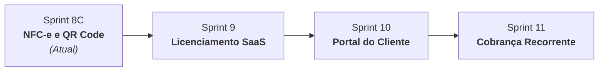

# 📊 Estado Oficial do Projeto — GESTOR MEI

> [!IMPORTANT]
> **REGRA DE MANUTENÇÃO CONTÍNUA:**
> Este documento reflete o estado oficial, homologado e em tempo real do **Gestor MEI**. Sempre que uma sprint, módulo ou marco de desenvolvimento for concluído, o assistente Antigravity deve atualizar este arquivo automaticamente antes de encerrar o ciclo de tarefas.

---

## 🏢 Identificação do Projeto

- **Empresa Mantenedora:** LPTI Tech
- **Produto:** GESTOR MEI
- **Versão Atual:** `1.4.0` (Refinamento Visual 8.5.1 Homologado)
- **Tipo de Aplicação:** SaaS Multiempresa B2B (Foco em MEIs e Pequenos Negócios)

---

## 🚀 Sprints Concluídas e Homologadas (100% Funcionais)

| Sprint | Versão | Escopo Entregue | Status |
| :--- | :---: | :--- | :---: |
| **Sprint 1** | `1.0.0` | **Núcleo SaaS Essencial:** Autenticação JWT, Dashboard Executivo, Catálogo de Produtos e Serviços, PDV Rápido (<10s), Controle de Caixa com Fechamento Cego, Despesas e Relatório Anual DASN-SIMEI (Teto de R$ 81.000,00). | Homologado |
| **Sprint 2** | `1.0.5` | **Carrinho Relacional & Clientes:** Vendas 1:N com múltiplos itens, cadastro de clientes com integração WhatsApp e cálculo automático de totais. | Homologado |
| **Sprint 3** | `1.0.8` | **Logística & Delivery:** Regiões e taxas de entrega, Kanban operacional de pedidos (*Recebido $\to$ Preparo $\to$ Em Rota $\to$ Entregue*), vinculação de motoboys e impressão térmica ESC/POS. | Homologado |
| **Sprint 4** | `1.1.0` | **Controle de Estoque & Custos:** Kardex de movimentações (Entrada, Saída, Ajuste, Perda), alerta de estoque mínimo no Dashboard e atualização de custo de reposição. | Homologado |
| **Sprint 5** | `1.2.0` | **Controle DAS Mensal:** Gerenciamento das 12 guias anuais do MEI, marcação de liquidação, alertas de vencimento (crítico/atenção) e atalho para o portal PGMEI. | Homologado |
| **Sprint 6** | `1.2.5` | **Entrada XML NF-e:** Parser SEFAZ v4.00, memória De-Para de códigos de fornecedores, conversão automática de embalagens e entrada no estoque. | Homologado |
| **Sprint 6.5**| `1.3.0` | **Gestão de Compras & Fornecedores:** Dashboard analítico de compras, detalhamento de custos unitários e relação de fornecedores parceiros. | Homologado |
| **Sprint 7** | `1.4.0` | **Painel do Consultor LPTI Tech:** Perfil `CONSULTOR`, visão multi-carteira, termômetro de saúde do negócio (Saudável, Atenção, Crítico) e parecer consultivo. | Homologado |
| **Sprint 8A/8B**| `1.4.0` | **Compra Manual & RBAC Estrito:** Lançamento de compras sem NF-e, upload de comprovantes, cadastro inline de produtos e blindagem de segurança para operadores. | Homologado |
| **Sprint 8.5.1**| `1.4.0` | **Refinamento Visual Executivo:** Logo ampliada em 30% no login, hierarquia visual sem vazios, ampliação da Sidebar para 280px com alinhamento vertical balanceado (Logo, GESTOR MEI, ERP). | Homologado |
| **Sprint UX 1** | `1.4.1` | **Design System Dashboard:** Modernização executiva inspirada em Stripe/Asaas/Conta Azul: KPI cards com icon bubbles e `tnum`, Alertas DAS executivos com borda acentuada, Resultado Financeiro com 3 cards pastel e Gráficos Recharts estilizados. | Homologado |
| **Sprint UX 2** | `1.4.2` | **Design System Controle de Estoque:** Modernização executiva completa: Page Header padrão Shopify com ações destacadas, Alerta Executivo com borda acentuada e botão de filtro rápido, Tabs modernas com badges de contagem, Tabela SaaS com cabeçalho ardósia e pills de saldo/status, e Modais com raio de 16px e sombra multicamada. | Homologado |
| **Sprint UX 3** | `1.4.3` | **Design System Módulo Clientes:** Page Header padrão Shopify Admin com ações alinhadas à direita, Toolbar de busca Asaas com filtros segmentados, Tabela de Clientes padrão Stripe com cabeçalho ardósia, avatar circular com iniciais, botões rápidos WhatsApp/Telefone, valores em `tnum` e pills de status, Empty State executivo com ícone e CTA, e Modal Novo/Editar categorizado em 4 seções (Identificação, Contato, Endereço e Preferências) com raio de 16px. | Homologado |
| **Sprint UX 4** | `1.4.4` | **Design System Produtos & Serviços:** Page Header padrão Shopify Admin com badge DASN-SIMEI, 4 KPI cards executivos (Total no Catálogo, Produtos & Mercadorias, Serviços Prestados e Categorias Ativas), Toolbar Asaas com busca rápida, seletor segmentado de tipos e filtro por categoria, Tabela de Produtos padrão Stripe com cabeçalho ardósia, avatar temático por tipo fiscal, preços em `tnum` com detalhamento de custo e margem percentual, pills de estoque com alerta de reposição, e Modal Novo/Editar Item categorizado em 4 seções executivas (Tributação DASN, Identificação, Precificação com cálculo em tempo real de margem bruta, e Controle de Estoque) com raio de 16px. | Homologado |
| **Sprint UX 5** | `1.4.5` | **Design System PDV / Terminal de Vendas:** Page Header padrão Shopify Admin com indicador de terminal ativo, catálogo estilo Shopify POS com cards táteis e pills de saldo de estoque, seletor segmentado Balcão vs Delivery padrão Asaas, carrinho ágil com steppers de quantidade, breakdown de subtotais e taxas, Totalizador de alto impacto visual (32px em `tnum`), seletor de Formas de Pagamento em botões táteis padrão Stripe Terminal (Dinheiro, PIX, Débito, Crédito) com estados ativos em alto contraste, checkout em 1 clique, tabela de vendas recentes com cabeçalho ardósia e modais refinados (comanda térmica, item avulso e estoque insuficiente) com raio de 16px. | Homologado |

---

## 🎯 Próxima Sprint (Em Execução / Imediata)

### 📌 **Sprint 8C — NFC-e e QR Code**
- **Objetivo:** Habilitar a emissão de Nota Fiscal de Consumidor Eletrônica (modelo 65) diretamente no PDV, homologada junto à SEFAZ.
- **Entregáveis:**
  1. Configuração dos parâmetros fiscais da empresa (Inscrição Estadual, Certificado A1 PKCS#12, Senha, CSC e IdCSC).
  2. Assinatura digital do XML da NFC-e e transmissão síncrona para a SEFAZ estadual.
  3. Geração do QR Code oficial de conferência pública.
  4. Impressão do DANFE simplificado em impressoras térmicas ESC/POS (58mm e 80mm).

---

## 🗺️ Backlog Aprovado

1. **Sprint 9 — Licenciamento SaaS:**
   - Planos comerciais: **START** (R$ 39,90), **DELIVERY PRO** (R$ 59,90) e **FULL MEI** (R$ 89,90).
   - Gestão automatizada de ciclo de vida: `TRIAL` (14 dias), `ATIVA`, `SUSPENSA` (somente leitura) e `CANCELADA`.
   - Período de carência de 5 dias corridos pós-vencimento (Grace Period) e suspensão no 6º dia.
2. **Sprint 10 — Portal do Cliente:**
   - Cardápio/catálogo digital público para clientes finais realizarem pedidos online pelo navegador ou celular.
   - Consulta de status de entrega e 2ª via de comprovantes/XMLs.
3. **Sprint 11 — Cobrança Recorrente:**
   - Integração com gateway Asaas para emissão automática de PIX e boletos recorrentes.
   - Geração de QR Code PIX dinâmico na tela do PDV com conciliação automática.

---

## 🛠️ Skills Instaladas no Antigravity

| Skill | Escopo de Atuação | Localização no Repositório |
| :--- | :--- | :--- |
| **`gestor-mei-core`** | Identidade oficial LPTI Tech, stack, módulos homologados e arquitetura. | [`.agents/skills/gestor-mei-core/`](file:///c:/Users/LeonidasPaulino/Desktop/gestor-mei-main/.agents/skills/gestor-mei-core/) |
| **`gestor-mei-ui-system`** | Sistema de design executivo padrão Stripe/Asaas, eliminando layouts genéricos. | [`.agents/skills/gestor-mei-ui-system/`](file:///c:/Users/LeonidasPaulino/Desktop/gestor-mei-main/.agents/skills/gestor-mei-ui-system/) |
| **`gestor-mei-rbac`** | Blindagem das regras de acesso (MASTER, OWNER, CONSULTOR e OPERATOR). | [`.agents/skills/gestor-mei-rbac/`](file:///c:/Users/LeonidasPaulino/Desktop/gestor-mei-main/.agents/skills/gestor-mei-rbac/) |
| **`gestor-mei-saas`** | Arquitetura de monetização, planos e ciclo de licenças da Sprint 9. | [`.agents/skills/gestor-mei-saas/`](file:///c:/Users/LeonidasPaulino/Desktop/gestor-mei-main/.agents/skills/gestor-mei-saas/) |
| **`lpti-brand-guidelines`** | Proteção da propriedade intelectual: Gestor MEI (Produto) e LPTI Tech (Desenvolvedora). | [`.agents/skills/lpti-brand-guidelines/`](file:///c:/Users/LeonidasPaulino/Desktop/gestor-mei-main/.agents/skills/lpti-brand-guidelines/) |

---

## 🔌 MCPs (Model Context Protocol) Planejados & Disponíveis

1. **Google Developer Knowledge:**
   - *Status:* Plugin Oficial de Marketplace (`antigravity-plugins-official/plugin/google-developer-knowledge`).
   - *Função:* Consulta de documentação técnica oficial e grounding de APIs.
2. **Chrome DevTools:**
   - *Status:* Plugin Oficial de Marketplace (`antigravity-plugins-official/plugin/chrome-devtools-plugin`).
   - *Função:* Automação e depuração em tempo real no navegador Chrome via Puppeteer.
3. **Browser (Browserbase):**
   - *Status:* Plugin Parceiro de Marketplace (`antigravity-plugins-partners/plugin/browse`).
   - *Função:* Navegação web real e extração de dados.
4. **GitHub MCP:**
   - *Status:* Configurado no template local Stdio (`mcp_config.template.json`) via `@modelcontextprotocol/server-github`.

---

## 🌐 Infraestrutura & URLs Oficiais

### Ambientes de Produção (Nuvem)
- **Frontend (Vercel):** `https://gestor-mei.vercel.app` *(ou domínio oficial `https://gestormei.com.br`)*
- **Backend (Render):** `https://gestor-mei-backend.onrender.com`
- **Documentação Swagger (Produção):** `https://gestor-mei-backend.onrender.com/docs`
- **Banco de Dados (Neon):** PostgreSQL 16 Serverless com pool de conexões e SSL obrigatório.

### Ambiente Local de Desenvolvimento
- **Frontend (Vite):** [http://localhost:5173](http://localhost:5173)
- **Backend (FastAPI / Uvicorn):** [http://localhost:8001](http://localhost:8001)
- **Swagger / OpenAPI (Local):** [http://localhost:8001/docs](http://localhost:8001/docs)
- **Banco Local:** SQLite (`gestor_mei.db`) com inicialização zero-config.
- **Script de Inicialização Rápida:** [`iniciar-gestor-mei.bat`](file:///c:/Users/LeonidasPaulino/Desktop/gestor-mei-main/iniciar-gestor-mei.bat) (na raiz do projeto).
